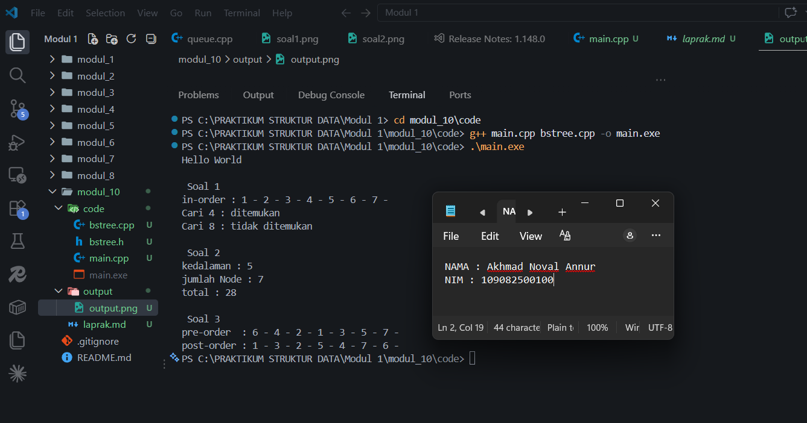

<h1 align="center">Laporan Praktikum Modul 10 - Tree (Bagian Pertama)</h1>

<p align="center">Akhmad Noval Annur - 109082500100 - S1IF-13-04</p>

## Dasar Teori

### A. Rekursif

Rekursif adalah sub program yang memanggil dirinya sendiri selama kondisi pemanggilan dipenuhi. Rekursif umumnya dipakai untuk permasalahan yang langkah penyelesaiannya terpola atau teratur, misalnya perhitungan faktorial dengan `n! = n * (n-1)!` dan `0! = 1! = 1` [2]. Sub program rekursif harus memiliki kondisi khusus yang menghentikan pemanggilan (*base case*) dan pemanggilan diri dengan parameter yang mendekati kondisi khusus tersebut. Kekurangan rekursif adalah kebutuhan memori dan waktu yang lebih besar karena setiap pemanggilan menyimpan *activation record* dan variabel lokal sampai pemanggilan tersebut selesai.

### B. Tree dan Binary Search Tree

Tree adalah struktur data non-linear yang digunakan untuk merepresentasikan hubungan data yang bersifat hierarkis. Salah satu elemennya disebut *root* (akar), sedangkan elemen lainnya terbagi menjadi himpunan yang tidak saling berhubungan yang disebut *subtree*. Berbeda dengan graph, tree tidak memiliki *cycle* [1]. Node yang memiliki anak disebut *parent*, anak dari sebuah node disebut *child*, dan node yang tidak memiliki anak disebut *leaf*.

Binary tree adalah tree yang setiap node-nya memiliki paling banyak dua anak, yaitu anak kiri dan anak kanan. Binary Search Tree (BST) adalah binary tree yang terurut: semua nilai pada subtree kiri lebih kecil dari parent-nya, dan semua nilai pada subtree kanan lebih besar dari parent-nya. Karena aturan tersebut, operasi *insert* dan *search* cukup membandingkan nilai dengan node saat ini lalu turun ke kiri atau ke kanan. Setiap subtree juga merupakan BST, sehingga kedua operasi tersebut dapat ditulis secara rekursif.

### C. Traversal

Traversal adalah proses mengunjungi seluruh node pada tree. Terdapat tiga cara traversal pada binary tree:

1. **Pre-order:** kunjungi root, lalu subtree kiri, lalu subtree kanan.
2. **In-order:** kunjungi subtree kiri, lalu root, lalu subtree kanan. Pada BST, in-order menghasilkan data yang terurut dari kecil ke besar.
3. **Post-order:** kunjungi subtree kiri, lalu subtree kanan, lalu root.

## Soal

1. Buatlah ADT Binary Search Tree menggunakan linked list di dalam file `bstree.h` (infotype integer, address pointer to Node, Node berisi info, left, dan right) dengan function `alokasi`, procedure `insertNode`, function `findNode`, dan procedure `printInorder`. Implementasikan pada `bstree.cpp` dan coba pada `main.cpp`.
2. Buatlah fungsi `hitungJumlahNode(root)` untuk menghitung banyak node, `hitungTotalInfo(root, start)` untuk menghitung total info, dan `hitungKedalaman(root, start)` untuk menghitung kedalaman maksimal tree secara rekursif.
3. Print tree pada Gambar 10-18 secara pre-order dan post-order.

Ketiga soal dikerjakan dalam satu program. `bstree.h` dan `bstree.cpp` berisi seluruh fungsi ADT dari soal 1 sampai soal 3, sedangkan `main.cpp` menjalankan ketiga soal secara berurutan. Pada `main.cpp` modul, pemanggilan fungsi ditulis `InOrder`, `hitungNode`, dan `hitungTotal`, sedangkan spesifikasi ADT memakai nama `printInorder`, `hitungJumlahNode`, dan `hitungTotalInfo`. Program ini memakai nama sesuai spesifikasi ADT.

### Program ADT Binary Search Tree

[Sumber program](code)

**bstree.h**

```cpp
#ifndef BSTREE_H
#define BSTREE_H

#define Nil nullptr

typedef int infotype;
typedef struct Node* address;

struct Node {
    infotype info;
    address left;
    address right;
};

address alokasi(infotype x);
void insertNode(address& root, infotype x);
address findNode(infotype x, address root);
void printInorder(address root);

int hitungJumlahNode(address root);
int hitungTotalInfo(address root, int start);
int hitungKedalaman(address root, int start);

void printPreorder(address root);
void printPostorder(address root);

#endif
```

**bstree.cpp**

```cpp
#include "bstree.h"

#include <iostream>

address alokasi(infotype x) {
    address p = new Node;
    p->info = x;
    p->left = Nil;
    p->right = Nil;
    return p;
}

void insertNode(address& root, infotype x) {
    if (root == Nil) {
        root = alokasi(x);
    } else if (x < root->info) {
        insertNode(root->left, x);
    } else if (x > root->info) {
        insertNode(root->right, x);
    }
}

address findNode(infotype x, address root) {
    if (root == Nil || root->info == x) {
        return root;
    }
    if (x < root->info) {
        return findNode(x, root->left);
    }
    return findNode(x, root->right);
}

void printInorder(address root) {
    if (root != Nil) {
        printInorder(root->left);
        std::cout << root->info << " - ";
        printInorder(root->right);
    }
}

int hitungJumlahNode(address root) {
    if (root == Nil) {
        return 0;
    }
    return 1 + hitungJumlahNode(root->left) + hitungJumlahNode(root->right);
}

int hitungTotalInfo(address root, int start) {
    if (root == Nil) {
        return start;
    }
    start = hitungTotalInfo(root->left, start + root->info);
    return hitungTotalInfo(root->right, start);
}

int hitungKedalaman(address root, int start) {
    if (root == Nil) {
        return start;
    }
    int kiri = hitungKedalaman(root->left, start + 1);
    int kanan = hitungKedalaman(root->right, start + 1);
    return kiri > kanan ? kiri : kanan;
}

void printPreorder(address root) {
    if (root != Nil) {
        std::cout << root->info << " - ";
        printPreorder(root->left);
        printPreorder(root->right);
    }
}

void printPostorder(address root) {
    if (root != Nil) {
        printPostorder(root->left);
        printPostorder(root->right);
        std::cout << root->info << " - ";
    }
}
```

**main.cpp**

```cpp
#include "bstree.h"

#include <iostream>

using namespace std;

int main() {
    cout << "Hello World" << endl;

    cout << "\n Soal 1 " << endl;
    address root = Nil;
    insertNode(root, 1);
    insertNode(root, 2);
    insertNode(root, 6);
    insertNode(root, 4);
    insertNode(root, 5);
    insertNode(root, 3);
    insertNode(root, 6);
    insertNode(root, 7);
    cout << "in-order : ";
    printInorder(root);
    cout << endl;

    address p = findNode(4, root);
    cout << "Cari 4 : " << (p != Nil ? "ditemukan" : "tidak ditemukan") << endl;
    p = findNode(8, root);
    cout << "Cari 8 : " << (p != Nil ? "ditemukan" : "tidak ditemukan") << endl;

    cout << "\n Soal 2 " << endl;
    cout << "kedalaman : " << hitungKedalaman(root, 0) << endl;
    cout << "jumlah Node : " << hitungJumlahNode(root) << endl;
    cout << "total : " << hitungTotalInfo(root, 0) << endl;

    cout << "\n Soal 3 " << endl;
    address root2 = Nil;
    insertNode(root2, 6);
    insertNode(root2, 4);
    insertNode(root2, 7);
    insertNode(root2, 2);
    insertNode(root2, 5);
    insertNode(root2, 1);
    insertNode(root2, 3);
    cout << "pre-order  : ";
    printPreorder(root2);
    cout << endl;
    cout << "post-order : ";
    printPostorder(root2);
    cout << endl;

    return 0;
}
```

#### Output



### 1. ADT Binary Search Tree

`insertNode` membandingkan nilai baru dengan node saat ini. Jika lebih kecil, nilai dimasukkan ke subtree kiri, dan jika lebih besar, nilai dimasukkan ke subtree kanan. Saat pointer sudah `Nil`, node baru dibuat dengan `alokasi`. Parameter `root` dikirim dengan referensi (`address&`) agar node baru langsung tersambung ke `left` atau `right` milik parent-nya. Nilai 6 yang dimasukkan dua kali tidak disisipkan lagi karena BST tidak menyimpan nilai yang sama, sehingga tree hanya berisi 7 node dengan bentuk berikut.

```text
1
 \
  2
   \
    6
   / \
  4   7
 / \
3   5
```

`printInorder` menampilkan subtree kiri, root, lalu subtree kanan, sehingga data tampil terurut `1 - 2 - 3 - 4 - 5 - 6 - 7 -` walaupun urutan insert-nya acak. Hasil ini sama dengan output pada modul. `findNode` mencari dengan cara yang sama seperti insert dan mengembalikan alamat node jika ditemukan atau `Nil` jika tidak ada. Pada output, nilai 4 ditemukan, sedangkan nilai 8 tidak ada di dalam tree.

### 2. Menghitung Jumlah Node, Total Info, dan Kedalaman

Ketiga fungsi ditulis secara rekursif dengan kondisi berhenti saat `root == Nil`. `hitungJumlahNode` mengembalikan 0 untuk tree kosong, sedangkan untuk node yang ada mengembalikan 1 ditambah jumlah node subtree kiri dan kanan. `hitungTotalInfo` memakai `start` sebagai penampung jumlah sementara: info node saat ini ditambahkan ke `start`, lalu hasilnya diteruskan ke subtree kiri dan kemudian ke subtree kanan. `hitungKedalaman` menambah `start` sebesar 1 setiap turun satu level dan mengambil nilai terbesar dari subtree kiri dan kanan.

Soal 2 memakai tree yang sama dengan soal 1, yaitu 7 node dengan total `1 + 2 + 3 + 4 + 5 + 6 + 7 = 28`. Lintasan terpanjangnya adalah 1 → 2 → 6 → 4 → 3 (atau 1 → 2 → 6 → 4 → 5) yang terdiri dari 5 node, sehingga kedalamannya 5. Hasil ini sama dengan output pada modul.

### 3. Traversal Pre-order dan Post-order

Tree pada Gambar 10-18 memiliki root 6 dengan anak kiri 4 dan anak kanan 7. Node 4 memiliki anak 2 dan 5, sedangkan node 2 memiliki anak 1 dan 3. Tree ini disimpan pada `root2` dan dibentuk dengan urutan insert 6, 4, 7, 2, 5, 1, 3, yaitu parent selalu dimasukkan sebelum anak-anaknya.

```text
        6
       / \
      4   7
     / \
    2   5
   / \
  1   3
```

`printPreorder` mencetak root terlebih dahulu, sehingga 6 muncul paling awal, kemudian seluruh subtree kiri (4, 2, 1, 3, 5) dan terakhir subtree kanan (7). `printPostorder` mencetak kedua subtree terlebih dahulu, sehingga leaf paling kiri yaitu 1 muncul pertama dan root 6 muncul paling akhir.

## Kesimpulan

Fungsi rekursif memanggil dirinya sendiri sampai kondisi khusus terpenuhi, dan cara ini cocok untuk tree karena setiap subtree juga merupakan tree. ADT Binary Search Tree berhasil dibuat dengan linked list, di mana nilai yang lebih kecil disimpan di subtree kiri dan nilai yang lebih besar di subtree kanan. Operasi `insertNode`, `findNode`, `printInorder`, `hitungJumlahNode`, `hitungTotalInfo`, `hitungKedalaman`, `printPreorder`, dan `printPostorder` seluruhnya ditulis secara rekursif dengan kondisi berhenti saat pointer bernilai `Nil`. Program menghasilkan in-order `1 - 2 - 3 - 4 - 5 - 6 - 7 -`, kedalaman 5, jumlah node 7, dan total 28 sesuai output pada modul. Tree pada Gambar 10-18 menghasilkan pre-order `6 - 4 - 2 - 1 - 3 - 5 - 7 -` dan post-order `1 - 3 - 2 - 5 - 4 - 7 - 6 -`.

## Referensi

[1] Triase. (2020). *Diktat Edisi Revisi: Struktur Data*. Universitas Islam Negeri Sumatera Utara, Medan. [Dokumen PDF](https://repository.uinsu.ac.id/9717/2/Diktat%20Struktur%20Data.pdf).

[2] Indahyanti, U., & Rahmawati, Y. (2020). *Buku Ajar Algoritma dan Pemrograman dalam Bahasa C++*. Umsida Press. [https://doi.org/10.21070/2020/978-623-6833-67-4](https://doi.org/10.21070/2020/978-623-6833-67-4).
