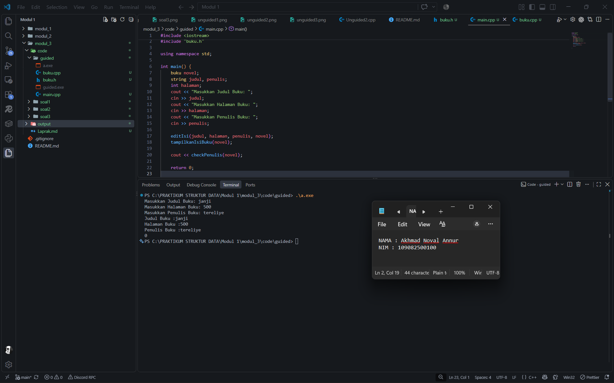
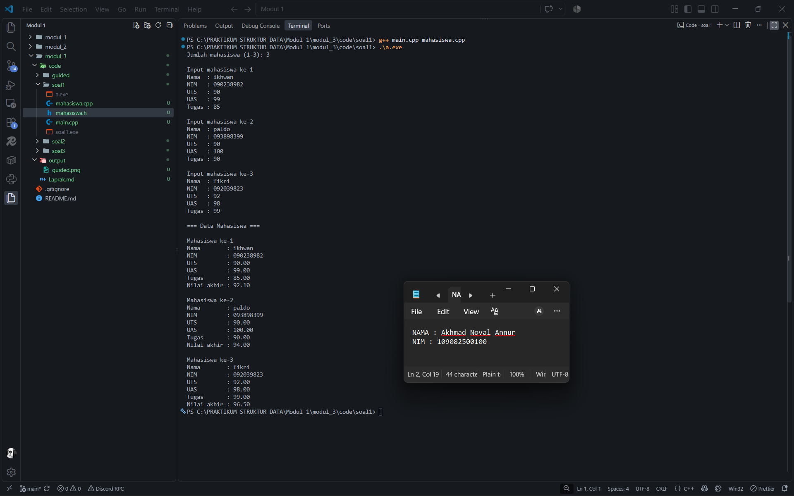
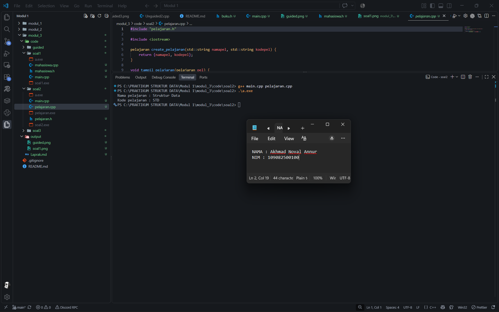
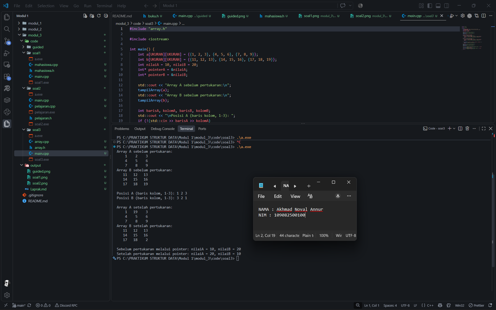

<h1 align="center">Laporan Praktikum Modul 3 - Abstract Data Type (ADT)</h1>

<p align="center">Akhmad Noval Annur - 109082500100 - S1IF-13-04</p>

**Sumber latihan:** Modul 03 STUKDAT.pdf, halaman cetak 32-35. Guided mengikuti program ADT buku pada berkas praktikum


### 1. Abstract Data Type

Menurut modul, ADT terdiri atas tipe data dan sekumpulan operasi dasar atau primitif terhadap tipe tersebut. Spesifikasi ADT juga dapat memuat invarian, yaitu kondisi yang harus dipenuhi data, serta aksioma yang menjelaskan hubungan antaroperasi. Contohnya, data mahasiswa mengelompokkan NIM dan nilai, lalu menyediakan operasi untuk membaca data serta menghitung rata-rata.

Dalam praktikum ini, tipe bentukan diwujudkan sebagai `struct`. Field menyimpan komponen data, sedangkan fungsi dan procedure mewujudkan operasi terhadap data tersebut. Fungsi mengembalikan hasil, sementara procedure bertipe `void` melakukan tindakan seperti menampilkan data. Pemisahan pekerjaan menjadi fungsi dan procedure menerapkan pemrograman modular [2].

### 2. Pemisahan program ADT

Modul membagi program menjadi file header, file implementasi, dan driver. File `.h` memuat tipe serta deklarasi operasi; file `.cpp` memuat realisasi operasi; `main.cpp` menggunakan operasi tersebut. Header guard mencegah deklarasi tipe dimasukkan berulang kali dalam satu unit kompilasi. Saat membangun program, `main.cpp` dan file implementasi harus dikompilasi bersama.

Kreator seperti `create_pelajaran` membentuk nilai tipe bentukan. Operasi baca menerima reference agar dapat mengisi data milik pemanggil. Operasi perhitungan dan tampilan yang hanya membaca data mahasiswa menggunakan `const mahasiswa&`.

### 3. Array dan pointer

Array menyimpan elemen sejenis. Array `mahasiswa data[3]` menyediakan tiga tempat untuk record mahasiswa, sedangkan `int a[3][3]` menyediakan sembilan bilangan bulat dalam tiga baris dan tiga kolom. Indeks array C++ dimulai dari nol, sehingga indeks yang valid pada array 3 x 3 adalah 0 sampai 2.

Pointer menyimpan alamat objek. Operator `&` mengambil alamat variabel, sedangkan `*` mengakses nilai pada alamat tersebut [1]. Procedure pertukaran menggunakan variabel sementara agar nilai pertama tetap tersedia setelah tempatnya diisi nilai kedua.


## Guided

### ADT buku

Program guided mengelompokkan judul, jumlah halaman, dan penulis ke dalam tipe `buku`. Procedure `editIsi` mengisi record, `tampilkanIsiBuku` menampilkan isinya, dan fungsi `checkPenulis` memeriksa apakah field penulis kosong.

#### `buku.h`

[Sumber program](code/guided/buku.h)

```cpp
#ifndef BUKU_H
#define BUKU_H
#include <iostream>

using namespace std;

struct buku {
    string judul;
    int halaman;
    string penulis;

};

void editIsi(string judul, int halaman, string penulis, buku &buku);
void tampilkanIsiBuku(buku buku);
bool checkPenulis(buku buku);


#endif
```

#### `buku.cpp`

[Sumber program](code/guided/buku.cpp)

```cpp
#include "buku.h"

using namespace std;

void editIsi(string judul, int halaman, string penulis, buku &buku) {
    buku.judul = judul;
    buku.halaman = halaman;
    buku.penulis = penulis;
}

void tampilkanIsiBuku(buku buku) {
    cout << "Judul Buku :" << buku.judul << endl;
    cout << "Halaman Buku :" << buku.halaman << endl;
    cout << "Penulis Buku :" << buku.penulis << endl;

}

bool checkPenulis(buku buku) {
    return buku.penulis == "";
}
```

#### `main.cpp`

[Sumber program](code/guided/main.cpp)

```cpp
#include <iostream>
#include "buku.h"

using namespace std;

int main() {
    buku novel;
    string judul, penulis;
    int halaman;
    cout << "Masukkan Judul Buku: ";
    cin >> judul;
    cout << "Masukkan Halaman Buku: ";
    cin >> halaman;
    cout << "Masukkan Penulis Buku: ";
    cin >> penulis;

    editIsi(judul, halaman, penulis, novel);
    tampilkanIsiBuku(novel);

    cout << checkPenulis(novel);

    return 0;


}
```

**Penjelasan:** `buku.h` mendefinisikan tipe `buku` serta deklarasi operasinya. `buku.cpp` merealisasikan operasi tersebut, sedangkan `main.cpp` membaca input dan memanggil operasi ADT. Parameter `buku&` pada `editIsi` membuat perubahan judul, halaman, dan penulis tersimpan pada variabel `novel` milik pemanggil.

Pada gambar output, input judul adalah `janji`, jumlah halaman `500`, dan penulis `tereliye`. Procedure tampilan menampilkan kembali ketiga data tersebut. Fungsi `checkPenulis` mengevaluasi `buku.penulis == ""`. Karena penulis terisi, hasilnya `false` dan dicetak sebagai `0`. Input judul dan penulis menggunakan `cin >>`, sehingga masing-masing dibaca sebagai satu kata.

#### Output Guided



## Latihan

### 1. Array data mahasiswa dan perhitungan nilai akhir

**Soal:** Simpan maksimal 10 mahasiswa ke dalam array dengan field nama, NIM, UTS, UAS, tugas, dan nilai akhir. Nilai akhir harus diperoleh dari fungsi dengan rumus `0.3 * uts + 0.4 * uas + 0.3 * tugas`.

**Penyesuaian:** Sesuai permintaan pengguna, kapasitas program dibatasi menjadi maksimal **3 mahasiswa**.

#### `mahasiswa.h`

[Sumber program](code/soal1/mahasiswa.h)

```cpp
#ifndef MAHASISWA_H_INCLUDED
#define MAHASISWA_H_INCLUDED

#include <string>

const int MAKS_MAHASISWA = 3;

struct mahasiswa {
    std::string nama;
    std::string nim;
    double uts;
    double uas;
    double tugas;
    double nilaiAkhir;
};

double hitungNilaiAkhir(double uts, double uas, double tugas);
mahasiswa create_mahasiswa(const std::string& nama, const std::string& nim,
                           double uts, double uas, double tugas);
bool inputMahasiswa(mahasiswa& m);
void tampilMahasiswa(const mahasiswa& m);

#endif
```

#### `mahasiswa.cpp`

[Sumber program](code/soal1/mahasiswa.cpp)

```cpp
#include "mahasiswa.h"

#include <cmath>
#include <iomanip>
#include <iostream>

double hitungNilaiAkhir(double uts, double uas, double tugas) {
    return 0.3 * uts + 0.4 * uas + 0.3 * tugas;
}

mahasiswa create_mahasiswa(const std::string& nama, const std::string& nim,
                           double uts, double uas, double tugas) {
    return {nama, nim, uts, uas, tugas, hitungNilaiAkhir(uts, uas, tugas)};
}

bool inputMahasiswa(mahasiswa& m) {
    std::string nama, nim;
    double uts, uas, tugas;

    std::cout << "Nama  : ";
    if (!std::getline(std::cin >> std::ws, nama) || nama.empty()) {
        return false;
    }
    std::cout << "NIM   : ";
    if (!(std::cin >> nim)) {
        return false;
    }
    std::cout << "UTS   : ";
    if (!(std::cin >> uts) || !std::isfinite(uts) || uts < 0 || uts > 100) {
        return false;
    }
    std::cout << "UAS   : ";
    if (!(std::cin >> uas) || !std::isfinite(uas) || uas < 0 || uas > 100) {
        return false;
    }
    std::cout << "Tugas : ";
    if (!(std::cin >> tugas) || !std::isfinite(tugas) || tugas < 0 || tugas > 100) {
        return false;
    }

    m = create_mahasiswa(nama, nim, uts, uas, tugas);
    return true;
}

void tampilMahasiswa(const mahasiswa& m) {
    std::cout << "Nama        : " << m.nama << '\n'
              << "NIM         : " << m.nim << '\n'
              << std::fixed << std::setprecision(2)
              << "UTS         : " << m.uts << '\n'
              << "UAS         : " << m.uas << '\n'
              << "Tugas       : " << m.tugas << '\n'
              << "Nilai akhir : " << m.nilaiAkhir << '\n';
}
```

#### `main.cpp`

[Sumber program](code/soal1/main.cpp)

```cpp
#include "mahasiswa.h"

#include <iostream>

int main() {
    mahasiswa data[MAKS_MAHASISWA]{};
    int jumlah;

    std::cout << "Jumlah mahasiswa (1-3): ";
    if (!(std::cin >> jumlah) || jumlah < 1 || jumlah > MAKS_MAHASISWA) {
        std::cerr << "Jumlah mahasiswa harus bilangan bulat 1 sampai 3.\n";
        return 1;
    }

    for (int i = 0; i < jumlah; ++i) {
        std::cout << "\nInput mahasiswa ke-" << i + 1 << '\n';
        if (!inputMahasiswa(data[i])) {
            std::cerr << "Input tidak valid. Nama dan NIM wajib diisi; "
                      << "nilai harus berupa angka 0 sampai 100.\n";
            return 1;
        }
    }

    std::cout << "\n=== Data Mahasiswa ===\n";
    for (int i = 0; i < jumlah; ++i) {
        std::cout << "\nMahasiswa ke-" << i + 1 << '\n';
        tampilMahasiswa(data[i]);
    }
    return 0;
}
```

**Penjelasan:** `data` merupakan array berkapasitas 3 record mahasiswa. Banyak data yang diisi ditentukan oleh input `jumlah`; program ini meminta minimal satu mahasiswa dan menolak jumlah di luar 1 sampai 3 sebelum mengakses array.

Field `nama` dan `nim` menggunakan `std::string`. `getline` membaca nama yang mengandung spasi, sedangkan `std::ws` melewati newline yang tertinggal setelah input sebelumnya. NIM disimpan sebagai teks agar seluruh digit dan nol di awal tetap tersimpan. UTS, UAS, tugas, dan nilai akhir menggunakan `double` agar mendukung nilai pecahan. Program membatasi nilai masukan pada angka hingga 100 dan tidak kurang dari nol.

Fungsi `hitungNilaiAkhir` mengembalikan hasil perhitungan berbobot. Kreator `create_mahasiswa` mengisi semua field sekaligus, termasuk nilai akhir, sehingga nilai akhir konsisten dengan tiga komponen nilai saat record dibuat. Procedure `tampilMahasiswa` menampilkan setiap record dengan dua angka di belakang koma; pembulatan hanya terjadi pada tampilan.

Gambar output menampilkan tiga mahasiswa dengan hasil berikut:

| Nama | NIM | UTS | UAS | Tugas | Nilai akhir |
| --- | --- | ---: | ---: | ---: | ---: |
| ikhwan | 090238982 | 90 | 99 | 85 | 92.10 |
| paldo | 093898399 | 90 | 100 | 90 | 94.00 |
| fikri | 092039823 | 92 | 98 | 99 | 96.50 |

Perhitungan ikhwan adalah `0.3 * 90 + 0.4 * 99 + 0.3 * 85 = 27 + 39.6 + 25.5 = 92.1`. Perhitungan paldo adalah `27 + 40 + 27 = 94`. Perhitungan fikri adalah `27.6 + 39.2 + 29.7 = 96.5`. Ketiga hasil sesuai dengan nilai akhir pada tangkapan layar.

#### Output Soal 1



### 2. ADT pelajaran

**Soal:** Buat `pelajaran.h` dengan field `namaMapel` dan `kodeMapel`, fungsi `create_pelajaran`, serta procedure `tampil_pelajaran`. Realisasikan operasinya dalam `pelajaran.cpp` dan uji melalui `main.cpp` dengan nama `Struktur Data` serta kode `STD`.

#### `pelajaran.h`

[Sumber program](code/soal2/pelajaran.h)

```cpp
#ifndef PELAJARAN_H_INCLUDED
#define PELAJARAN_H_INCLUDED

#include <string>

struct pelajaran {
    std::string namaMapel;
    std::string kodeMapel;
};

pelajaran create_pelajaran(std::string namapel, std::string kodepel);
void tampil_pelajaran(pelajaran pel);

#endif
```

#### `pelajaran.cpp`

[Sumber program](code/soal2/pelajaran.cpp)

```cpp
#include "pelajaran.h"

#include <iostream>

pelajaran create_pelajaran(std::string namapel, std::string kodepel) {
    return {namapel, kodepel};
}

void tampil_pelajaran(pelajaran pel) {
    std::cout << "Nama pelajaran : " << pel.namaMapel << '\n'
              << "Kode pelajaran : " << pel.kodeMapel << '\n';
}
```

#### `main.cpp`

[Sumber program](code/soal2/main.cpp)

```cpp
#include "pelajaran.h"

#include <string>

int main() {
    std::string namapel = "Struktur Data";
    std::string kodepel = "STD";
    pelajaran pel = create_pelajaran(namapel, kodepel);
    tampil_pelajaran(pel);
    return 0;
}
```

**Penjelasan:** Header mendefinisikan tipe `pelajaran` dan mendeklarasikan dua operasi sesuai soal. Fungsi `create_pelajaran` mengembalikan record yang berisi nama dan kode dari parameter. Procedure `tampil_pelajaran` membaca kedua field lalu menampilkannya.

Driver mengikuti data dan urutan pemanggilan pada modul: membuat variabel `namapel` dan `kodepel`, membentuk `pel`, lalu memanggil procedure tampilan. Program menghasilkan nama pelajaran `Struktur Data` dan kode `STD`.

#### Output Soal 2



### 3. Pertukaran elemen array 2D dan nilai melalui pointer

**Soal:** Buat dua array integer 3 x 3 dan dua pointer integer. Sediakan fungsi atau procedure untuk menampilkan array, menukar elemen kedua array pada posisi tertentu, serta menukar nilai variabel yang ditunjuk dua pointer.

#### `array.h`

[Sumber program](code/soal3/array.h)

```cpp
#ifndef ARRAY_H_INCLUDED
#define ARRAY_H_INCLUDED

const int UKURAN = 3;

void tampilArray(const int data[][UKURAN]);
bool tukarElemen(int a[][UKURAN], int b[][UKURAN],
                 int barisA, int kolomA, int barisB, int kolomB);
void tukarPointer(int* a, int* b);

#endif
```

#### `array.cpp`

[Sumber program](code/soal3/array.cpp)

```cpp
#include "array.h"

#include <iomanip>
#include <iostream>

void tampilArray(const int data[][UKURAN]) {
    for (int i = 0; i < UKURAN; ++i) {
        for (int j = 0; j < UKURAN; ++j) {
            std::cout << std::setw(5) << data[i][j];
        }
        std::cout << '\n';
    }
}

bool tukarElemen(int a[][UKURAN], int b[][UKURAN],
                 int barisA, int kolomA, int barisB, int kolomB) {
    if (barisA < 0 || barisA >= UKURAN || kolomA < 0 || kolomA >= UKURAN
        || barisB < 0 || barisB >= UKURAN || kolomB < 0 || kolomB >= UKURAN) {
        return false;
    }
    const int sementara = a[barisA][kolomA];
    a[barisA][kolomA] = b[barisB][kolomB];
    b[barisB][kolomB] = sementara;
    return true;
}

void tukarPointer(int* a, int* b) {
    const int sementara = *a;
    *a = *b;
    *b = sementara;
}
```

#### `main.cpp`

[Sumber program](code/soal3/main.cpp)

```cpp
#include "array.h"

#include <iostream>

int main() {
    int a[UKURAN][UKURAN] = {{1, 2, 3}, {4, 5, 6}, {7, 8, 9}};
    int b[UKURAN][UKURAN] = {{11, 12, 13}, {14, 15, 16}, {17, 18, 19}};
    int nilaiA = 10, nilaiB = 20;
    int* pointerA = &nilaiA;
    int* pointerB = &nilaiB;

    std::cout << "Array A sebelum pertukaran:\n";
    tampilArray(a);
    std::cout << "Array B sebelum pertukaran:\n";
    tampilArray(b);

    int barisA, kolomA, barisB, kolomB;
    std::cout << "\nPosisi A (baris kolom, 1-3): ";
    if (!(std::cin >> barisA >> kolomA)
        || barisA < 1 || barisA > UKURAN || kolomA < 1 || kolomA > UKURAN) {
        std::cerr << "Posisi harus berupa bilangan bulat 1 sampai 3.\n";
        return 1;
    }
    std::cout << "Posisi B (baris kolom, 1-3): ";
    if (!(std::cin >> barisB >> kolomB)
        || barisB < 1 || barisB > UKURAN || kolomB < 1 || kolomB > UKURAN) {
        std::cerr << "Posisi harus berupa bilangan bulat 1 sampai 3.\n";
        return 1;
    }

    if (!tukarElemen(a, b, barisA - 1, kolomA - 1, barisB - 1, kolomB - 1)) {
        std::cerr << "Indeks array tidak valid.\n";
        return 1;
    }
    std::cout << "\nArray A setelah pertukaran:\n";
    tampilArray(a);
    std::cout << "Array B setelah pertukaran:\n";
    tampilArray(b);

    std::cout << "\nSebelum pertukaran melalui pointer: nilaiA = " << nilaiA
              << ", nilaiB = " << nilaiB << '\n';
    tukarPointer(pointerA, pointerB);
    std::cout << "Setelah pertukaran melalui pointer: nilaiA = " << nilaiA
              << ", nilaiB = " << nilaiB << '\n';
    return 0;
}
```

**Penjelasan:** Program menyediakan array A berisi 1 sampai 9 dan array B berisi 11 sampai 19. Procedure `tampilArray` memakai perulangan baris dan kolom untuk menampilkan isi array 3 x 3.

Soal tidak menentukan apakah posisi di kedua array harus sama. Implementasi ini meminta posisi pada A dan B secara terpisah; pengguna dapat memilih posisi yang sama maupun berbeda. Pengguna memasukkan nomor baris dan kolom 1 sampai 3, kemudian driver menguranginya dengan satu untuk memperoleh indeks C++. Validasi dilakukan sebelum konversi dan sebelum mengakses elemen array.

`tukarElemen` juga memeriksa seluruh indeks sebagai batasan operasi. Jika indeks valid, satu elemen A ditukar dengan satu elemen B memakai variabel sementara, lalu fungsi mengembalikan `true`. Elemen lain tetap berada di tempatnya. Hasil pada gambar menunjukkan pertukaran elemen A pada baris 1 kolom 2, yaitu `2`, dengan elemen B pada baris 3 kolom 3, yaitu `19`. Setelah pertukaran, baris pertama A menjadi `1 19 3`, sedangkan baris ketiga B menjadi `17 18 2`. Elemen lainnya tetap sama. Pada tangkapan layar terdapat angka tambahan saat memasukkan posisi; `cin` membaca dua angka per pasangan secara berurutan, sehingga pasangan yang terpakai adalah A `(1, 2)` dan B `(3, 3)`.

Variabel `nilaiA = 10` dan `nilaiB = 20` ditunjuk oleh `pointerA` dan `pointerB`. Procedure `tukarPointer` mengubah nilai variabel melalui dereference. Setelah procedure dipanggil, `nilaiA` menjadi `20` dan `nilaiB` menjadi `10`. Kedua pointer tetap menunjuk variabel yang sama seperti sebelumnya; isi variabelnya yang berubah. Prasyarat procedure adalah kedua pointer menunjuk objek `int` yang masih hidup, dan driver memenuhinya dengan alamat dua variabel lokal.

#### Output Soal 3



## Cara Menjalankan

### Code::Blocks

1. Buat proyek **Console application** dengan bahasa C++ untuk satu subfolder, misalnya `soal2`.
2. Gunakan `main.cpp` dari subfolder tersebut sebagai driver, menggantikan `main.cpp` bawaan proyek.
3. Tambahkan file implementasi dan header dari subfolder yang sama ke proyek. Untuk Soal 2, tambahkan `pelajaran.cpp` dan `pelajaran.h`.
4. Pilih **Build and Run**. Ulangi dengan proyek terpisah untuk guided dan tiap soal.

Setiap proyek harus menyertakan file implementasi `.cpp` bersama `main.cpp`. Memasukkan semua `main.cpp` dari beberapa soal ke satu proyek akan menghasilkan lebih dari satu titik masuk program.

### g++ melalui PowerShell

Jalankan perintah berikut dari folder utama repositori:

```powershell
# Guided
 g++ -std=c++17 -Wall -Wextra -Wpedantic modul_3/code/guided/main.cpp modul_3/code/guided/buku.cpp -o modul_3/code/guided/guided.exe
 .\modul_3\code\guided\guided.exe

# Soal 1
 g++ -std=c++17 -Wall -Wextra -Wpedantic modul_3/code/soal1/main.cpp modul_3/code/soal1/mahasiswa.cpp -o modul_3/code/soal1/soal1.exe
 .\modul_3\code\soal1\soal1.exe

# Soal 2
 g++ -std=c++17 -Wall -Wextra -Wpedantic modul_3/code/soal2/main.cpp modul_3/code/soal2/pelajaran.cpp -o modul_3/code/soal2/soal2.exe
 .\modul_3\code\soal2\soal2.exe

# Soal 3
 g++ -std=c++17 -Wall -Wextra -Wpedantic modul_3/code/soal3/main.cpp modul_3/code/soal3/array.cpp -o modul_3/code/soal3/soal3.exe
 .\modul_3\code\soal3\soal3.exe
```

## Verifikasi

Keempat program pada berkas saat ini berhasil dikompilasi dengan g++ menggunakan C++17 dan opsi `-Wall -Wextra -Wpedantic -Werror`, tanpa warning. Eksekusi dengan input pada gambar menghasilkan data berikut:

| Program | Hasil |
| --- | --- |
| Guided | Buku `janji`, 500 halaman, penulis `tereliye`, hasil `checkPenulis` adalah `0` |
| Soal 1 | Tiga mahasiswa dengan nilai akhir ikhwan `92.10`, paldo `94.00`, dan fikri `96.50` |
| Soal 2 | Nama pelajaran `Struktur Data` dan kode `STD` |
| Soal 3 | Elemen `2` dan `19` bertukar; nilai melalui pointer berubah dari `(10, 20)` menjadi `(20, 10)` |

Seluruh gambar output ditampilkan langsung pada bagian guided dan masing-masing latihan menggunakan tangkapan layar terbaru dari folder `output`.

## Kesimpulan

Pemisahan header, implementasi, dan driver membuat operasi data dapat digunakan melalui deklarasi yang jelas. ADT buku mengelompokkan informasi buku dan operasi terhadapnya. ADT mahasiswa mengelompokkan data dan perhitungannya, sedangkan ADT pelajaran menyediakan kreator serta procedure tampilan. Array menampung beberapa record atau elemen matriks, dan pointer memungkinkan procedure mengubah nilai variabel pemanggil melalui alamatnya.

## Referensi

[1] Triase. (2020). *Diktat Edisi Revisi: Struktur Data*. Universitas Islam Negeri Sumatera Utara, Medan. [Dokumen PDF](https://repository.uinsu.ac.id/9717/2/Diktat%20Struktur%20Data.pdf).

[2] Indahyanti, U., & Rahmawati, Y. (2020). *Buku Ajar Algoritma dan Pemrograman dalam Bahasa C++*. Umsida Press. [https://doi.org/10.21070/2020/978-623-6833-67-4](https://doi.org/10.21070/2020/978-623-6833-67-4).
