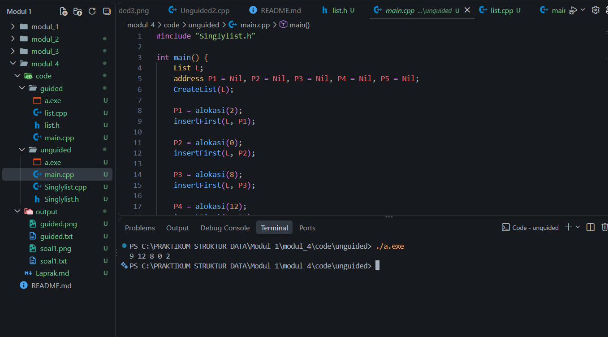

<h1 align="center">Laporan Praktikum Modul 4 - Singly Linked List (Bagian Pertama)</h1>

<p align="center">Akhmad Noval Annur - 109082500100 - S1IF-13-04</p>

**Sumber:** Modul 04 STUKDAT.pdf, halaman cetak 36-46.

## Dasar Teori

### 1. Singly linked list

Singly linked list merupakan kumpulan node yang terhubung melalui pointer satu arah. Setiap node menyimpan informasi dan pointer `next` menuju node berikutnya. Pointer kepala menunjuk node pertama, sedangkan `next` pada node terakhir bernilai `nullptr`. List kosong ditandai oleh pointer kepala yang bernilai `nullptr` [1, hlm. 36-38].

Informasi dalam node dapat berupa data tunggal seperti bilangan bulat atau data majemuk seperti record mahasiswa. Operator `->` digunakan untuk mengakses field pada node melalui pointer. Penelusuran dilakukan dari node pertama dengan mengikuti `next` sampai mencapai akhir list.

### 2. Alokasi dan dealokasi

Alokasi membuat node baru menggunakan `new`. Data node diisi, lalu pointer `next` diinisialisasi agar mempunyai nilai yang jelas. Memori node yang sudah tidak digunakan dibebaskan menggunakan `delete`. Sebelum dibebaskan, node harus dilepas dari rangkaian list agar pointer pada list tidak menunjuk memori yang sudah dihapus [1, hlm. 38-39].

### 3. Operasi dasar

`insertFirst` menambahkan node pada awal list, `insertLast` menambahkan node pada akhir list, dan `insertAfter` menambahkan node setelah node tertentu. Saat menyisipkan node di tengah, hubungan ke node berikutnya disimpan terlebih dahulu agar sisa list tidak terputus [1, hlm. 39-42].

Penghapusan dapat dilakukan pada node pertama, node terakhir, atau node setelah suatu node. Pointer penghubung diperbarui sebelum memori node dibebaskan. Operasi tampilan menelusuri semua node dan mencetak informasi masing-masing node [1, hlm. 42-46].

## Guided

### Singly linked list data mahasiswa

Program Guided menggunakan record mahasiswa yang menyimpan nama, NIM, dan umur. Setiap node mempunyai field `isidata` untuk menyimpan record tersebut serta `next` untuk menunjuk node berikutnya. Pointer `first` pada `linkedlist` menjadi titik awal penelusuran.

#### `list.h`

[Sumber program](code/guided/list.h)

```cpp
#ifndef list_h
#define list_h
#define Nil NULL

#include <iostream>
using namespace std;

struct mahasiswa
{
    string nama, nim;
    int umur;
};

typedef mahasiswa dataMahasiswa;
typedef struct node *address;

struct node
{
    dataMahasiswa isidata;
    address next;
};
struct linkedlist
{
    address first;
};

bool isEmpty(linkedlist list);
void createList(linkedlist &list);
address alokasi(string name, string nim, int umur);
void dealokasi (address &node);
void printList(linkedlist list);
void insertFirst(linkedlist &list, address nodeBaru);
void insertAfter(linkedlist Glist, address nodeBaru, address prev);
void insertLast(linkedlist Glist, address nodeBaru);
void delPirst(linkedlist Glist);
void dellast (linkedlist Glist);
void delAfter (linkedlist list, address nodeHapus, address nodePrev);
int nbList(linkedlist list);
void delist (linkedlist Glist);

#endif
```

**Penjelasan:** Tipe `mahasiswa` mengelompokkan nama, NIM, dan umur. Alias `dataMahasiswa` dipakai sebagai tipe informasi node, sedangkan `address` menyimpan alamat sebuah `node`. Record `linkedlist` hanya menyimpan alamat node pertama. Nilai `Nil` menandai pointer kosong. Header memuat deklarasi operasi untuk membentuk list, mengalokasikan node, menyisipkan dan menghapus node, menampilkan data, serta menghitung jumlah node.

#### `list.cpp`

[Sumber program](code/guided/list.cpp)

```cpp
#include "list.h"
#include <iostream>
using namespace std;

bool isEmpty(linkedlist list)
{
    if (list.first = Nil)
    {
        return true;
    }
    else
    {
        return false;
    }
}

void createList (linkedlist &list)
{
    list.first = Nil;
}

address alokasi(string nama, string nim, int umur)
{
    address nodeBaru;
    nodeBaru = new node;
    nodeBaru->isidata.nama = nama;
    nodeBaru->isidata.nim = nim;
    nodeBaru->isidata.umur = umur;
    nodeBaru->next = Nil;
    return nodeBaru;
}

void dealokasi(address &node)
{
    delete node;
}

void insertFirst(linkedlist &list, address nodeBaru)
{
    nodeBaru->next = list.first;
    list.first = nodeBaru;
}

void insertAfter(linkedlist &list, address nodeBaru, address prev)
{
    if (prev != Nil)
    {
        nodeBaru->next = prev->next;
        prev->next = nodeBaru;
    }
    else
    {
        cout << "Node sebelumnya tidak valid." << endl;
    }
}

void insertLast(linkedlist &list, address nodeBaru)
{
    if (isEmpty(list))
    {
        list.first = nodeBaru;
    }
    else
    {
        address nodeBantu = list.first;
        while (nodeBantu->next != Nil)
        {
            nodeBantu = nodeBantu->next;
        }
        nodeBantu->next = nodeBaru;
    }
}

void delFirst(linkedlist &list)
{
    address nodeHapus;
    if (isEmpty(list) == false)
    {
        nodeHapus = list.first;
         list.first = list.first->next;
        nodeHapus->next = Nil;
        dealokasi(nodeHapus);
    }
    else
    {
        cout << "List kosong" << endl;
    }
}
void delLast(linkedlist &list)
{
    address nodeHapus, nodePrev;
    if (!isEmpty(list)==false)
    {
        nodeHapus = list.first;
        if (nodeHapus->next == Nil)
        {
            list.first->next = Nil;
            dealokasi(nodeHapus);
        }
        else
        {
            while (nodeHapus->next != Nil)
            {
                nodePrev = nodeHapus;
                nodeHapus = nodeHapus->next;
            }
            nodePrev->next = Nil;
            dealokasi(nodeHapus);
        }
    }
    else
    {
        cout << "List kosong" << endl;
    }
}

void delAfter(linkedlist &list, address nodeHapus, address nodePrev)
{
    if (isEmpty(list) == true)
    {
        cout << "list kosong!" << endl;
    }
    else
    {
        if (nodePrev != Nil && nodePrev->next != Nil)
        {
            nodeHapus = nodePrev->next;
            nodePrev->next = nodeHapus->next;
            nodeHapus->next = Nil;
            dealokasi(nodeHapus);
        }
        else
        {
            cout << "Node sebelumnya (prev) tidak valid!" << endl;
        }
    } 
}
void printlist(linkedlist list)
{
    if (isEmpty(list))
    {
        cout << "list kosong" << endl;
    }
    else
    {
        address nodeBantu = list.first;
        while (nodeBantu != Nil)
        {
            cout << "Nama: " << nodeBantu->isidata.nama << ", NIM: " << nodeBantu->isidata.nim << ", Usia: " << nodeBantu->isidata.umur << endl;
            nodeBantu = nodeBantu->next;
        }
    }
}

int nblist(linkedlist list)
{
    int count = 0;
    address nodeBantu = list.first;
    while (nodeBantu != Nil)
    {
        count++;
        nodeBantu = nodeBantu->next;
    }
    return count;
}

void deletelist(linkedlist &list)
{
    address nodeBantu, nodeHapus;
    nodeBantu = list.first;
    while (nodeBantu != Nil)
    {
        nodeHapus = nodeBantu;
        nodeBantu = nodeBantu->next;
        dealokasi(nodeHapus);
    }
    list.first = Nil;
    cout << "List sudah terhapus." << endl;
}
```

**Penjelasan:** `createList` menginisialisasi pointer kepala menjadi `Nil`. Fungsi `alokasi` membentuk node baru, mengisi nama, NIM, dan umur, lalu mengosongkan pointer `next`. Procedure `dealokasi` membebaskan memori node melalui `delete`.

`insertFirst` menyambungkan node baru ke kepala lama, kemudian memindahkan `first` ke node baru. `insertAfter` menyisipkan node setelah `prev` dengan mempertahankan hubungan ke penerusnya. `insertLast` menelusuri list hingga node terakhir sebelum menyambungkan node baru.

Operasi `delFirst`, `delLast`, dan `delAfter` ditujukan untuk melepas node pada posisi masing-masing lalu membebaskan memorinya. `printlist` menelusuri node dan menampilkan nama, NIM, serta umur. Fungsi `nblist` menghitung banyak node, sedangkan `deletelist` membebaskan seluruh node dan mengosongkan kepala list.

**Catatan kode saat ini:** Kondisi `isEmpty` masih menggunakan penugasan `list.first = Nil`; pemeriksaan kekosongan seharusnya menggunakan perbandingan `list.first == Nil`. Beberapa nama dan parameter deklarasi pada header juga berbeda dari implementasinya, misalnya `printList` dengan `printlist`, `nbList` dengan `nblist`, serta deklarasi operasi insert dan delete. Pada `delLast`, kondisi list dan pengosongan kepala ketika satu node dihapus juga perlu disesuaikan agar operasi aman. Penjelasan operasi di atas menyatakan tujuan masing-masing fungsi.

#### `main.cpp`

[Sumber program](code/guided/main.cpp)

```cpp
#include <iostream>
#include "list.h"
using namespace std;

int main()
{
    linkedlist list;
    address nodeA, nodeB, nodeC, nodeD, nodeE = Nil;
    createList(list);

    nodeA = alokasi("Dhimas", "001", 20);
    nodeB = alokasi("Budi", "002", 21);
    nodeC = alokasi("Andi", "003", 22);
    nodeD = alokasi("Caca", "004", 23);
    nodeE = alokasi("Dewi", "005", 24);
}
```

**Penjelasan:** Driver membuat list kosong, kemudian mengalokasikan lima node untuk Dhimas, Budi, Andi, Caca, dan Dewi. Masing-masing node berisi nama, NIM, dan umur sesuai parameter `alokasi`. Pada versi driver ini, node baru dialokasikan dan belum disisipkan ke list. Belum ada pemanggilan fungsi tampilan maupun pembebasan node, sehingga driver belum menampilkan hasil operasi list.

## Unguided

### 1. ADT Singly Linked List

**Soal:** Buat ADT pada `Singlylist.h` dengan `infotype` bertipe integer, pointer `address`, node `ElmList`, dan record `List`. Sediakan `CreateList`, `alokasi`, `dealokasi`, `printInfo`, dan `insertFirst`. Buat implementasinya pada `Singlylist.cpp`, lalu uji melalui `main.cpp` dengan nilai `2`, `0`, `8`, `12`, dan `9` yang dimasukkan menggunakan `insertFirst` [1, hlm. 43-44].

#### `Singlylist.h`

[Sumber program](code/unguided/Singlylist.h)

```cpp
#ifndef SINGLYLIST_H_INCLUDED
#define SINGLYLIST_H_INCLUDED

constexpr auto Nil = nullptr;
typedef int infotype;
typedef struct ElmList* address;

struct ElmList {
    infotype info;
    address next;
};

struct List {
    address First;
};

void CreateList(List& L);
address alokasi(infotype x);
void dealokasi(address& P);
void printInfo(List L);
void insertFirst(List& L, address P);

#endif
```

**Penjelasan:** `infotype` menentukan tipe informasi node, yaitu `int`. `address` merupakan pointer ke `ElmList`. Node menyimpan `info` dan `next`, sedangkan `List` menyimpan alamat node pertama pada `First`. Konstanta `Nil` menggunakan nilai `nullptr` untuk menandai pointer kosong.

#### `Singlylist.cpp`

[Sumber program](code/unguided/Singlylist.cpp)

```cpp
#include "Singlylist.h"

#include <iostream>

void CreateList(List& L) {
    L.First = Nil;
}

address alokasi(infotype x) {
    return new ElmList{x, Nil};
}

void dealokasi(address& P) {
    delete P;
    P = Nil;
}

void printInfo(List L) {
    address P = L.First;
    while (P != Nil) {
        std::cout << P->info;
        if (P->next != Nil) {
            std::cout << ' ';
        }
        P = P->next;
    }
    std::cout << '\n';
}

void insertFirst(List& L, address P) {
    if (P == Nil) {
        return;
    }
    P->next = L.First;
    L.First = P;
}
```

**Penjelasan:** `CreateList` mengosongkan `First`. `alokasi` membentuk node berisi nilai parameter dengan `next` kosong. `dealokasi` membebaskan node yang sudah dilepas lalu mengosongkan pointer pemanggil melalui reference. `printInfo` menampilkan semua nilai dengan menelusuri hubungan `next`.

Pada `insertFirst`, `P->next` diisi dengan kepala lama sebelum `L.First` diarahkan ke `P`. Dengan demikian, node baru berada di depan dan hubungan ke data sebelumnya tetap tersimpan.

#### `main.cpp`

[Sumber program](code/unguided/main.cpp)

```cpp
#include "Singlylist.h"

int main() {
    List L;
    address P1 = Nil, P2 = Nil, P3 = Nil, P4 = Nil, P5 = Nil;
    CreateList(L);

    P1 = alokasi(2);
    insertFirst(L, P1);

    P2 = alokasi(0);
    insertFirst(L, P2);

    P3 = alokasi(8);
    insertFirst(L, P3);

    P4 = alokasi(12);
    insertFirst(L, P4);

    P5 = alokasi(9);
    insertFirst(L, P5);

    printInfo(L);
    while (L.First != Nil) {
        address P = L.First;
        L.First = P->next;
        dealokasi(P);
    }
    P1 = P2 = P3 = P4 = P5 = Nil;
    return 0;
}
```

**Penjelasan:** Driver mengikuti urutan data pada soal. Setiap nilai baru dimasukkan ke awal list, sehingga urutan akhir berlawanan dengan urutan masuknya data.

| Langkah | Nilai yang dimasukkan | Isi list |
| --- | ---: | --- |
| Awal | - | Kosong |
| 1 | 2 | `2` |
| 2 | 0 | `0 2` |
| 3 | 8 | `8 0 2` |
| 4 | 12 | `12 8 0 2` |
| 5 | 9 | `9 12 8 0 2` |

Setelah hasil ditampilkan, perulangan melepas node dari awal dan memanggil `dealokasi` sampai list kosong. Nama `CreateList` digunakan secara konsisten pada deklarasi, implementasi, dan pemanggilan karena C++ membedakan huruf besar dan kecil.

#### Output Unguided

```text
9 12 8 0 2
```



Tangkapan layar menunjukkan hasil eksekusi program berupa `9 12 8 0 2`. Urutan ini sesuai ilustrasi pada halaman 43-44 modul karena setiap nilai disisipkan pada awal list.

## Cara Menjalankan

1. Buat proyek **Console application** C++ pada Code::Blocks.
2. Tambahkan `main.cpp`, `Singlylist.cpp`, dan `Singlylist.h` dari folder `code/unguided`.
3. Pastikan hanya ada satu fungsi `main` pada proyek dan standar compiler minimal C++11.
4. Pilih **Build and Run**. Program langsung menampilkan hasil tanpa meminta input.

## Hasil Pengujian

Program Unguided berhasil dikompilasi dengan g++ menggunakan standar C++17 dan opsi `-Wall -Wextra -Wpedantic -Werror`, tanpa warning. Hasil pada tangkapan layar adalah `9 12 8 0 2`, sesuai urutan penyisipan pada soal.

## Kesimpulan

Singly linked list menghubungkan setiap node melalui pointer satu arah. Penyisipan dan penghapusan dilakukan dengan memperbarui hubungan antar-node. Pada latihan, pemanggilan `insertFirst` untuk nilai `2`, `0`, `8`, `12`, dan `9` menghasilkan urutan `9 12 8 0 2`. Setiap node yang tidak lagi dipakai dibebaskan menggunakan `delete`.

## Referensi

[1] Triase. (2020). *Diktat Edisi Revisi: Struktur Data*. Universitas Islam Negeri Sumatera Utara, Medan. [Dokumen PDF](https://repository.uinsu.ac.id/9717/2/Diktat%20Struktur%20Data.pdf).

[2] Indahyanti, U., & Rahmawati, Y. (2020). *Buku Ajar Algoritma dan Pemrograman dalam Bahasa C++*. Umsida Press. [https://doi.org/10.21070/2020/978-623-6833-67-4](https://doi.org/10.21070/2020/978-623-6833-67-4).
