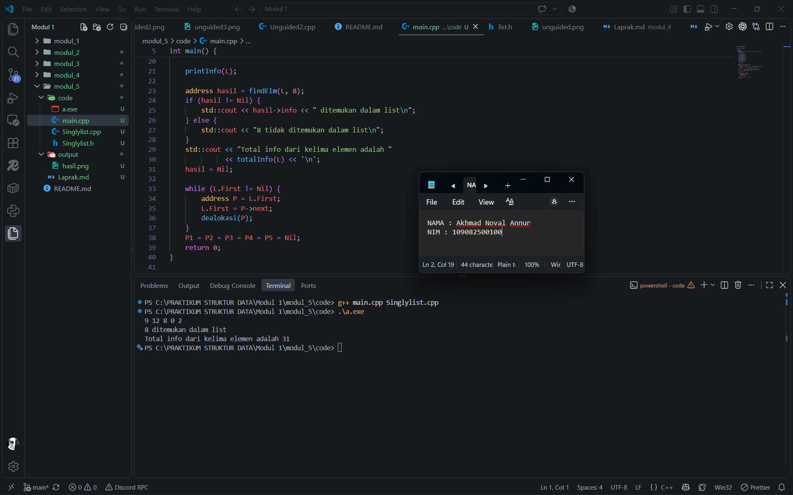

# Laporan Praktikum Modul 5 - Singly Linked List 

<p align="center">Akhmad Noval Annur - 109082500100 - S1IF-13-04</p>

## Dasar Teori

### A. Singly Linked List

Singly linked list merupakan struktur data yang tersusun dari node. Setiap node menyimpan nilai dan pointer menuju node berikutnya. Node dapat diakses secara berurutan dari kepala list sampai node terakhir [1]. Dalam implementasi praktikum, `info` menyimpan bilangan bulat, `next` menyimpan alamat penerus, dan `First` menyimpan alamat node pertama. Pointer `next` pada node terakhir bernilai `Nil`, sedangkan list kosong ditandai dengan `First == Nil` [3].

`CreateList` membentuk list kosong. `alokasi` membuat node menggunakan `new`, sedangkan `dealokasi` membebaskan node menggunakan `delete`. Operasi `insertFirst` menyambungkan node baru ke node pertama lama, kemudian memperbarui kepala list. Oleh karena itu, penyisipan nilai `2`, `0`, `8`, `12`, dan `9` secara berturut-turut menghasilkan list `9 12 8 0 2` [3].

### B. Searching dan Penelusuran List

Pencarian pada singly linked list biasa memerlukan pemeriksaan node secara berurutan [2]. Fungsi `findElm` memulai pencarian dari kepala dan mengikuti pointer `next` hingga menemukan nilai yang sesuai atau mencapai `Nil`. Jika ditemukan, fungsi mengembalikan alamat node; jika tidak, fungsi mengembalikan `Nil`. Modul juga mengenalkan `fFindElm` untuk memeriksa keberadaan alamat serta `findBefore` untuk mencari node sebelum alamat tertentu [3].

Penelusuran juga digunakan untuk memproses seluruh informasi dalam list [1]. Dalam latihan ini, jumlah seluruh info dihitung dengan akumulator yang dimulai dari nol. Setiap nilai node ditambahkan satu kali hingga akhir list, sehingga diperoleh `9 + 12 + 8 + 0 + 2 = 31`. Jumlah info tersebut berbeda dengan jumlah node, yaitu lima. Berdasarkan perulangan pada implementasi, pencarian dan penjumlahan masing-masing memerlukan waktu O(n) pada kasus terburuk.

## Soal

### 1. Buatlah ADT Singly Linked List, masukkan nilai 2, 0, 8, 12, dan 9 menggunakan insertFirst, cari elemen dengan info 8, dan hitung total info seluruh elemen.

**Singlylist.h**

```cpp
#ifndef SINGLYLIST_H
#define SINGLYLIST_H

constexpr auto Nil = nullptr;
typedef int infotype;
typedef struct ElmList* address;

struct ElmList {
    infotype info;
    address next;
};

struct List {
    address First;
};

void CreateList(List& L);
address alokasi(infotype x);
void dealokasi(address& P);
void printInfo(List L);
void insertFirst(List& L, address P);
address findElm(List L, infotype x);
int totalInfo(List L);

#endif
```

**Singlylist.cpp**

```cpp
#include "Singlylist.h"

#include <iostream>

void CreateList(List& L) {
    L.First = Nil;
}

address alokasi(infotype x) {
    return new ElmList{x, Nil};
}

void dealokasi(address& P) {
    delete P;
    P = Nil;
}

void printInfo(List L) {
    address P = L.First;
    while (P != Nil) {
        std::cout << P->info;
        if (P->next != Nil) {
            std::cout << ' ';
        }
        P = P->next;
    }
    std::cout << '\n';
}

void insertFirst(List& L, address P) {
    if (P == Nil) {
        return;
    }
    P->next = L.First;
    L.First = P;
}

address findElm(List L, infotype x) {
    address P = L.First;
    while (P != Nil && P->info != x) {
        P = P->next;
    }
    return P;
}

int totalInfo(List L) {
    int total = 0;
    for (address P = L.First; P != Nil; P = P->next) {
        total += P->info;
    }
    return total;
}
```

**main.cpp**

```cpp
#include "Singlylist.h"

#include <iostream>

int main() {
    List L;
    address P1 = Nil, P2 = Nil, P3 = Nil, P4 = Nil, P5 = Nil;
    CreateList(L);

    P1 = alokasi(2);
    insertFirst(L, P1);
    P2 = alokasi(0);
    insertFirst(L, P2);
    P3 = alokasi(8);
    insertFirst(L, P3);
    P4 = alokasi(12);
    insertFirst(L, P4);
    P5 = alokasi(9);
    insertFirst(L, P5);

    printInfo(L);

    address hasil = findElm(L, 8);
    if (hasil != Nil) {
        std::cout << hasil->info << " ditemukan dalam list\n";
    } else {
        std::cout << "8 tidak ditemukan dalam list\n";
    }
    std::cout << "Total info dari kelima elemen adalah "
              << totalInfo(L) << '\n';
    hasil = Nil;

    while (L.First != Nil) {
        address P = L.First;
        L.First = P->next;
        dealokasi(P);
    }
    P1 = P2 = P3 = P4 = P5 = Nil;
    return 0;
}
```

## Output



Program menggunakan satu ADT yang dipisahkan menjadi `Singlylist.h`, `Singlylist.cpp`, dan `main.cpp`. Header memuat tipe data dan deklarasi operasi, file implementasi memuat definisi operasi, sedangkan `main.cpp` menjalankan seluruh langkah dalam satu program.

`CreateList` membentuk list kosong. Lima node dialokasikan dan dimasukkan menggunakan `insertFirst` dengan urutan nilai `2`, `0`, `8`, `12`, dan `9`. Karena setiap node baru disisipkan di awal, isi list yang ditampilkan adalah `9 12 8 0 2`.

`findElm(L, 8)` menelusuri node dari awal dan mengembalikan alamat node berisi `8`, sehingga program menampilkan `8 ditemukan dalam list`. Selanjutnya, `totalInfo` menjumlahkan `9 + 12 + 8 + 0 + 2` dan menghasilkan `31`. Setelah seluruh hasil ditampilkan, setiap node dilepas dan memorinya dibebaskan menggunakan `dealokasi`.

## Kesimpulan

Singly linked list memungkinkan penyimpanan dan pengolahan data melalui node yang terhubung dengan pointer. Penyisipan nilai `2`, `0`, `8`, `12`, dan `9` menggunakan `insertFirst` menghasilkan `9 12 8 0 2`. Pencarian menggunakan `findElm` berhasil menemukan nilai `8`, sedangkan penelusuran seluruh node menghasilkan total info `31`. Node yang selesai digunakan dibebaskan agar memori dapat digunakan kembali.

## Referensi

[1] Li, Y., Tan, Y.-A., Wang, W., Zhang, Q., & Wang, Z. (2013). A Cache-conscious Structure Definition for List. *Journal of Applied Sciences, 13*(8), 1192-1198. [https://doi.org/10.3923/jas.2013.1192.1198](https://doi.org/10.3923/jas.2013.1192.1198).

[2] Bhatnagar, S. R. (2018). Speeding Up Search in Singly Linked List. *International Journal of Computer Applications, 182*(18), 19-24. [https://doi.org/10.5120/ijca2018917892](https://doi.org/10.5120/ijca2018917892).

