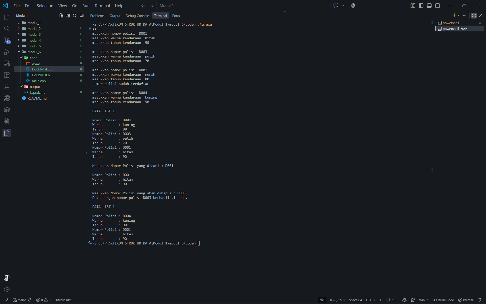

<h1 align="center">Laporan Praktikum Modul 6 - Doubly Linked List (Bagian Pertama)</h1>

<p align="center">Akhmad Noval Annur - 109082500100 - S1IF-13-04</p>

## Dasar Teori

### A. Doubly Linked List

Doubly linked list merupakan linked list yang setiap elemennya memiliki dua penunjuk, yaitu `prev` yang menunjuk elemen sebelumnya dan `next` yang menunjuk elemen sesudahnya [1]. List menyimpan dua pointer utama, yaitu `First` yang menunjuk elemen pertama dan `Last` yang menunjuk elemen terakhir. List kosong ditandai dengan `First == Nil` dan `Last == Nil`. Pointer `prev` pada elemen pertama dan `next` pada elemen terakhir bernilai `Nil`.

Karena memiliki dua arah penghubung, doubly linked list dapat ditelusuri maju dari `First` mengikuti `next` maupun mundur dari `Last` mengikuti `prev` [1]. Informasi pada elemen dapat berupa tipe bentukan (`struct`) yang berisi beberapa field, misalnya data kendaraan yang terdiri atas nomor polisi, warna, dan tahun pembuatan [2].

### B. Operasi Insert dan Delete

Pada `insertLast`, `prev` milik elemen baru diarahkan ke `Last`, `next` milik `Last` diarahkan ke elemen baru, kemudian `Last` dipindahkan ke elemen baru. Jika list masih kosong, `First` dan `Last` langsung menunjuk elemen baru [1].

`deleteFirst` memindahkan `First` ke elemen berikutnya lalu mengosongkan `prev` elemen pertama yang baru. `deleteLast` memindahkan `Last` ke elemen sebelumnya lalu mengosongkan `next` elemen terakhir yang baru. `deleteAfter` melepas elemen setelah `Prec` dengan menyambungkan `Prec->next` ke elemen sesudah `P`, serta mengarahkan `prev` milik elemen tersebut kembali ke `Prec`. Elemen yang sudah dilepas kemudian dibebaskan dari memori menggunakan `delete` [2].

Proses pencarian pada doubly linked list sama dengan singly linked list, yaitu memeriksa elemen satu per satu dari awal sampai data ditemukan atau mencapai `Nil` [1].

## Soal

### 1. Buatlah ADT Doubly Linked List dengan infotype kendaraan (nopol, warna, thnBuat) di dalam file Doublylist.h, implementasikan pada Doublylist.cpp, dan coba pada main.cpp.

### 2. Carilah elemen dengan nomor polisi D001 dengan membuat fungsi findElm(L : List, x : infotype) : address.

### 3. Hapus elemen dengan nomor polisi D003 dengan procedure deleteFirst, deleteLast, dan deleteAfter.

**Doublylist.h**

```cpp
#ifndef DOUBLYLIST_H
#define DOUBLYLIST_H

#include <string>

constexpr auto Nil = nullptr;

struct kendaraan {
    std::string nopol;
    std::string warna;
    int thnBuat;
};

typedef kendaraan infotype;
typedef struct ElmList* address;

struct ElmList {
    infotype info;
    address next;
    address prev;
};

struct List {
    address First;
    address Last;
};

void CreateList(List& L);
address alokasi(infotype x);
void dealokasi(address& P);
void printInfo(List L);
void insertLast(List& L, address P);
address findElm(List L, infotype x);
void deleteFirst(List& L, address& P);
void deleteLast(List& L, address& P);
void deleteAfter(address Prec, address& P);

#endif
```

**Doublylist.cpp**

```cpp
#include "Doublylist.h"

#include <iostream>

void CreateList(List& L) {
    L.First = Nil;
    L.Last = Nil;
}

address alokasi(infotype x) {
    return new ElmList{x, Nil, Nil};
}

void dealokasi(address& P) {
    delete P;
    P = Nil;
}

void printInfo(List L) {
    address P = L.Last;
    while (P != Nil) {
        std::cout << "Nomor Polisi : " << P->info.nopol << '\n';
        std::cout << "Warna        : " << P->info.warna << '\n';
        std::cout << "Tahun        : " << P->info.thnBuat << '\n';
        P = P->prev;
    }
}

void insertLast(List& L, address P) {
    if (P == Nil) {
        return;
    }
    if (L.First == Nil) {
        L.First = P;
        L.Last = P;
    } else {
        P->prev = L.Last;
        L.Last->next = P;
        L.Last = P;
    }
}

address findElm(List L, infotype x) {
    address P = L.First;
    while (P != Nil && P->info.nopol != x.nopol) {
        P = P->next;
    }
    return P;
}

void deleteFirst(List& L, address& P) {
    P = L.First;
    if (P == Nil) {
        return;
    }
    if (L.First == L.Last) {
        L.First = Nil;
        L.Last = Nil;
    } else {
        L.First = L.First->next;
        L.First->prev = Nil;
    }
    P->next = Nil;
    P->prev = Nil;
}

void deleteLast(List& L, address& P) {
    P = L.Last;
    if (P == Nil) {
        return;
    }
    if (L.First == L.Last) {
        L.First = Nil;
        L.Last = Nil;
    } else {
        L.Last = L.Last->prev;
        L.Last->next = Nil;
    }
    P->next = Nil;
    P->prev = Nil;
}

void deleteAfter(address Prec, address& P) {
    P = Prec->next;
    if (P == Nil) {
        return;
    }
    Prec->next = P->next;
    if (P->next != Nil) {
        P->next->prev = Prec;
    }
    P->next = Nil;
    P->prev = Nil;
}
```

**main.cpp**

```cpp
#include "Doublylist.h"

#include <iostream>

int main() {
    List L;
    CreateList(L);

    for (int i = 0; i < 4; i++) {
        infotype x;
        std::cout << "masukkan nomor polisi: ";
        std::cin >> x.nopol;
        std::cout << "masukkan warna kendaraan: ";
        std::cin >> x.warna;
        std::cout << "masukkan tahun kendaraan: ";
        std::cin >> x.thnBuat;

        if (findElm(L, x) != Nil) {
            std::cout << "nomor polisi sudah terdaftar\n";
        } else {
            insertLast(L, alokasi(x));
        }
        std::cout << '\n';
    }

    std::cout << "DATA LIST 1\n\n";
    printInfo(L);

    infotype cari;
    std::cout << "\nMasukkan Nomor Polisi yang dicari : ";
    std::cin >> cari.nopol;
    address hasil = findElm(L, cari);
    std::cout << '\n';
    if (hasil != Nil) {
        std::cout << "Nomor Polisi : " << hasil->info.nopol << '\n';
        std::cout << "Warna        : " << hasil->info.warna << '\n';
        std::cout << "Tahun        : " << hasil->info.thnBuat << '\n';
    } else {
        std::cout << "Nomor polisi " << cari.nopol << " tidak ditemukan.\n";
    }

    infotype hapus;
    std::cout << "\nMasukkan Nomor Polisi yang akan dihapus : ";
    std::cin >> hapus.nopol;
    address P = findElm(L, hapus);
    if (P != Nil) {
        if (P == L.First) {
            deleteFirst(L, P);
        } else if (P == L.Last) {
            deleteLast(L, P);
        } else {
            deleteAfter(P->prev, P);
        }
        dealokasi(P);
        std::cout << "Data dengan nomor polisi " << hapus.nopol
                  << " berhasil dihapus.\n";
    } else {
        std::cout << "Data dengan nomor polisi " << hapus.nopol
                  << " tidak ditemukan.\n";
    }

    std::cout << "\nDATA LIST 1\n\n";
    printInfo(L);

    while (L.First != Nil) {
        deleteFirst(L, P);
        dealokasi(P);
    }
    return 0;
}
```

## Output



Program menggunakan satu ADT yang dipisahkan menjadi `Doublylist.h`, `Doublylist.cpp`, dan `main.cpp`. Header memuat tipe `kendaraan`, elemen `ElmList` dengan pointer `next` dan `prev`, record `List` dengan `First` dan `Last`, serta deklarasi operasi. File implementasi memuat definisi operasi, sedangkan `main.cpp` menjalankan ketiga soal dalam satu program.

Pada soal 1, program meminta empat data kendaraan. Data `D001`, `D003`, dan `D004` dimasukkan menggunakan `insertLast`. Data ketiga dengan nomor polisi `D001` ditolak karena `findElm` menemukan nomor polisi yang sama, sehingga program menampilkan `nomor polisi sudah terdaftar`. `printInfo` menelusuri list dari `Last` mengikuti `prev`, sehingga data ditampilkan dengan urutan `D004`, `D003`, `D001` sesuai contoh output pada modul.

Pada soal 2, `findElm` menelusuri elemen dari `First` mengikuti `next` sampai menemukan nomor polisi `D001`, lalu program menampilkan nomor polisi, warna `hitam`, dan tahun `90`.

Pada soal 3, alamat elemen `D003` dicari terlebih dahulu menggunakan `findElm`. Karena `D003` bukan elemen pertama maupun terakhir, elemen tersebut dilepas menggunakan `deleteAfter(P->prev, P)`. Jika elemen yang dihapus berada di awal digunakan `deleteFirst`, dan jika berada di akhir digunakan `deleteLast`. Elemen yang dilepas dibebaskan menggunakan `dealokasi`, sehingga list yang tersisa adalah `D004` dan `D001`. Di akhir program, seluruh elemen dilepas dan memorinya dibebaskan.

## Kesimpulan

Doubly linked list menghubungkan setiap elemen dengan dua pointer, yaitu `next` dan `prev`, sehingga list dapat ditelusuri maju maupun mundur. Data kendaraan berhasil dimasukkan menggunakan `insertLast` dengan penolakan nomor polisi yang sudah terdaftar. Fungsi `findElm` berhasil menemukan kendaraan dengan nomor polisi `D001`, dan elemen `D003` berhasil dihapus menggunakan `deleteAfter` sehingga list tersisa `D004` dan `D001`. Elemen yang selesai digunakan dibebaskan agar memori dapat digunakan kembali.

## Referensi

[1] Triase. (2020). *Diktat Edisi Revisi: Struktur Data*. Universitas Islam Negeri Sumatera Utara, Medan. [Dokumen PDF](https://repository.uinsu.ac.id/9717/2/Diktat%20Struktur%20Data.pdf).

[2] Indahyanti, U., & Rahmawati, Y. (2020). *Buku Ajar Algoritma dan Pemrograman dalam Bahasa C++*. Umsida Press. [https://doi.org/10.21070/2020/978-623-6833-67-4](https://doi.org/10.21070/2020/978-623-6833-67-4).
