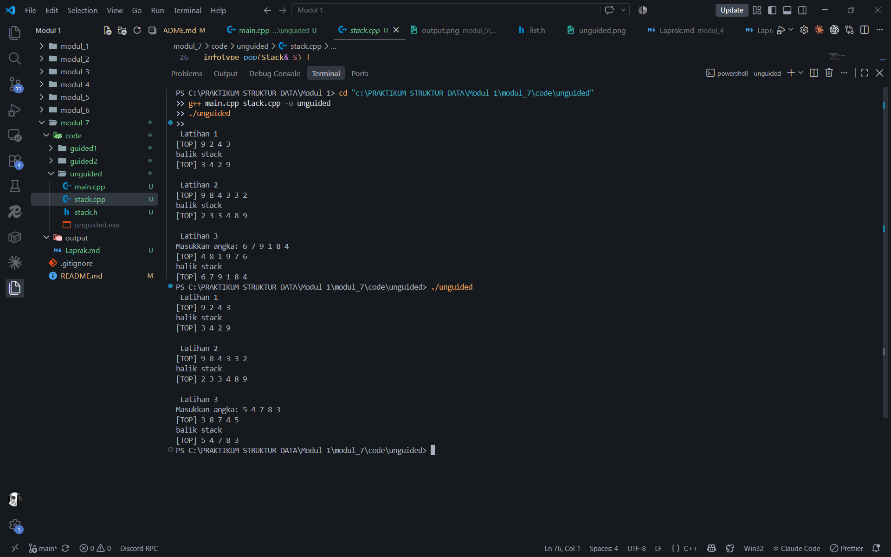

<h1 align="center">Laporan Praktikum Modul 7 - Stack</h1>

<p align="center">Akhmad Noval Annur - 109082500100 - S1IF-13-04</p>

## Dasar Teori

### A. Stack

Stack adalah struktur data yang bekerja seperti tumpukan. Elemen yang terakhir dimasukkan menjadi elemen yang pertama diambil, sehingga prinsipnya disebut LIFO (*Last In First Out*) [1]. Akses pada stack hanya dilakukan melalui satu ujung yang disebut `Top`. Stack dapat direpresentasikan dengan pointer, yaitu seperti singly linked list yang hanya diakses dari elemen pertama, atau dengan tabel (array) yang kapasitasnya terbatas [1].

### B. Stack Representasi Tabel

Pada representasi tabel, elemen stack disimpan dalam array berindeks dan posisi puncak dicatat dalam variabel `top`. Stack kosong ditandai dengan `top = 0`, sedangkan stack penuh terjadi ketika jumlah elemen sudah mencapai kapasitas array. Representasi ini tidak memerlukan alokasi dan dealokasi memori seperti representasi pointer [2].

### C. Operasi Push dan Pop

Operasi utama pada stack adalah `push` dan `pop`. `push` menyisipkan elemen baru di atas `Top`, sehingga mirip dengan *insert first* pada list. `pop` mengambil elemen pada posisi `Top` lalu memindahkan `Top` ke elemen di bawahnya, sehingga mirip dengan *delete first* pada list [1]. Pada representasi tabel, `push` menyimpan data lalu menaikkan `top`, sedangkan `pop` menurunkan `top` lalu mengembalikan data pada posisi tersebut tanpa perlu menghapus isi array [2].

## Guided

Program guided terdiri dari dua bagian: stack representasi tabel (array) dan stack representasi pointer (linked list). Keduanya menyediakan operasi `push`, `pop`, `update`, `view`, dan `searchData`. Posisi pada `update` dan `searchData` dihitung dari `Top`, sehingga posisi 1 adalah elemen paling atas.

### 1. Stack Representasi Tabel

[Sumber program](code/guided1)

**stack.h**

```cpp
#ifndef STACK_H
#define STACK_H

constexpr int MAX_STACK = 10;

struct Stack {
    int data[MAX_STACK];
    int top;
};

void createStack(Stack& S);
bool isEmpty(const Stack& S);
bool isFull(const Stack& S);
void push(Stack& S, int x);
void pop(Stack& S);
void update(Stack& S, int posisi, int nilaiBaru);
void view(const Stack& S);
void searchData(const Stack& S, int x);

#endif
```

**stack.cpp**

```cpp
#include "stack.h"

#include <iostream>

void createStack(Stack& S) {
    S.top = 0;
}

bool isEmpty(const Stack& S) {
    return S.top == 0;
}

bool isFull(const Stack& S) {
    return S.top == MAX_STACK;
}

void push(Stack& S, int x) {
    if (isFull(S)) {
        std::cout << "Stack penuh, " << x << " tidak dapat ditambahkan\n";
        return;
    }
    S.data[S.top] = x;
    S.top++;
    std::cout << "Push " << x << '\n';
}

void pop(Stack& S) {
    if (isEmpty(S)) {
        std::cout << "Stack kosong\n";
        return;
    }
    S.top--;
    std::cout << "Pop " << S.data[S.top] << '\n';
}

// posisi dihitung dari Top: posisi 1 adalah elemen paling atas
void update(Stack& S, int posisi, int nilaiBaru) {
    if (posisi < 1 || posisi > S.top) {
        std::cout << "Posisi " << posisi << " tidak valid\n";
        return;
    }
    int idx = S.top - posisi;
    std::cout << "Update posisi " << posisi << ": " << S.data[idx] << " -> " << nilaiBaru << '\n';
    S.data[idx] = nilaiBaru;
}

void view(const Stack& S) {
    std::cout << "[TOP]";
    for (int i = S.top - 1; i >= 0; i--) {
        std::cout << ' ' << S.data[i];
    }
    std::cout << '\n';
}

void searchData(const Stack& S, int x) {
    for (int i = S.top - 1; i >= 0; i--) {
        if (S.data[i] == x) {
            std::cout << "Data " << x << " ditemukan pada posisi " << S.top - i << '\n';
            return;
        }
    }
    std::cout << "Data " << x << " tidak ditemukan\n";
}
```

**main.cpp**

```cpp
#include "stack.h"

#include <iostream>

int main() {
    Stack S;
    createStack(S);

    for (int i = 1; i <= 5; i++) {
        push(S, i);
    }
    std::cout << "\nSetelah push\n";
    view(S);

    std::cout << '\n';
    pop(S);
    pop(S);
    std::cout << "\nSetelah pop 2 kali\n";
    view(S);

    std::cout << '\n';
    update(S, 1, 9);
    update(S, 2, 7);
    update(S, 5, 4);
    std::cout << "\nSetelah update\n";
    view(S);

    std::cout << '\n';
    searchData(S, 7);
    searchData(S, 4);
    return 0;
}
```

#### Output Guided 1

```text
Push 1
Push 2
Push 3
Push 4
Push 5

Setelah push
[TOP] 5 4 3 2 1

Pop 5
Pop 4

Setelah pop 2 kali
[TOP] 3 2 1

Update posisi 1: 3 -> 9
Update posisi 2: 2 -> 7
Posisi 5 tidak valid

Setelah update
[TOP] 9 7 1

Data 7 ditemukan pada posisi 2
Data 4 tidak ditemukan
```

Elemen disimpan pada array `data` dan `top` menyatakan jumlah elemen. Karena elemen teratas berada pada indeks `top - 1`, elemen pada posisi ke-`n` dari atas berada pada indeks `top - n`. Rumus ini dipakai `update`, sedangkan `searchData` menelusuri dari indeks teratas ke bawah dan mengubah indeks kembali menjadi posisi dengan `top - i`.

Setelah lima kali push dan dua kali pop, isi stack menjadi `[TOP] 3 2 1`. Posisi 1 diubah menjadi 9 dan posisi 2 menjadi 7, sedangkan posisi 5 ditolak karena stack hanya berisi tiga elemen. Data 7 ditemukan pada posisi 2, sedangkan data 4 sudah tidak ada karena telah di-pop.

### 2. Stack Representasi Pointer

[Sumber program](code/guided2)

**stack.h**

```cpp
#ifndef STACK_H
#define STACK_H

typedef struct Node* address;

struct Node {
    int info;
    address next;
};

struct Stack {
    address top;
};

void createStack(Stack& S);
bool isEmpty(const Stack& S);
address alokasi(int x);
void dealokasi(address& P);
void push(Stack& S, address P);
void pop(Stack& S);
void update(Stack& S, int posisi, int nilaiBaru);
void view(const Stack& S);
void searchData(const Stack& S, int x);
void clearStack(Stack& S);

#endif
```

**stack.cpp**

```cpp
#include "stack.h"

#include <iostream>

void createStack(Stack& S) {
    S.top = nullptr;
}

bool isEmpty(const Stack& S) {
    return S.top == nullptr;
}

address alokasi(int x) {
    address P = new Node;
    P->info = x;
    P->next = nullptr;
    return P;
}

void dealokasi(address& P) {
    delete P;
    P = nullptr;
}

void push(Stack& S, address P) {
    P->next = S.top;
    S.top = P;
    std::cout << "Push " << P->info << '\n';
}

void pop(Stack& S) {
    if (isEmpty(S)) {
        std::cout << "Stack kosong\n";
        return;
    }
    address P = S.top;
    S.top = P->next;
    P->next = nullptr;
    std::cout << "Pop " << P->info << '\n';
    dealokasi(P);
}

// posisi dihitung dari Top: posisi 1 adalah node paling atas
void update(Stack& S, int posisi, int nilaiBaru) {
    address P = S.top;
    int i = 1;
    while (P != nullptr && i < posisi) {
        P = P->next;
        i++;
    }
    if (posisi < 1 || P == nullptr) {
        std::cout << "Posisi " << posisi << " tidak valid\n";
        return;
    }
    std::cout << "Update posisi " << posisi << ": " << P->info << " -> " << nilaiBaru << '\n';
    P->info = nilaiBaru;
}

void view(const Stack& S) {
    std::cout << "[TOP]";
    for (address P = S.top; P != nullptr; P = P->next) {
        std::cout << ' ' << P->info;
    }
    std::cout << '\n';
}

void searchData(const Stack& S, int x) {
    int posisi = 1;
    for (address P = S.top; P != nullptr; P = P->next) {
        if (P->info == x) {
            std::cout << "Data " << x << " ditemukan pada posisi " << posisi << '\n';
            return;
        }
        posisi++;
    }
    std::cout << "Data " << x << " tidak ditemukan\n";
}

void clearStack(Stack& S) {
    while (!isEmpty(S)) {
        address P = S.top;
        S.top = P->next;
        dealokasi(P);
    }
}
```

**main.cpp**

```cpp
#include "stack.h"

#include <iostream>

int main() {
    Stack S;
    createStack(S);

    for (int i = 1; i <= 5; i++) {
        push(S, alokasi(i * 10));
    }
    std::cout << "\nSetelah push\n";
    view(S);

    std::cout << '\n';
    pop(S);
    pop(S);
    std::cout << "\nSetelah pop 2 kali\n";
    view(S);

    std::cout << '\n';
    update(S, 1, 35);
    update(S, 3, 15);
    update(S, 4, 99);
    std::cout << "\nSetelah update\n";
    view(S);

    std::cout << '\n';
    searchData(S, 20);
    searchData(S, 50);

    clearStack(S);
    return 0;
}
```

#### Output Guided 2

```text
Push 10
Push 20
Push 30
Push 40
Push 50

Setelah push
[TOP] 50 40 30 20 10

Pop 50
Pop 40

Setelah pop 2 kali
[TOP] 30 20 10

Update posisi 1: 30 -> 35
Update posisi 3: 10 -> 15
Posisi 4 tidak valid

Setelah update
[TOP] 35 20 15

Data 20 ditemukan pada posisi 2
Data 50 tidak ditemukan
```

Pada representasi pointer, `top` menunjuk node paling atas dan setiap node terhubung ke node di bawahnya melalui `next`. `push` bekerja seperti *insert first*: node baru diarahkan ke `top` lama, lalu `top` dipindahkan ke node baru. `pop` bekerja seperti *delete first*: `top` dipindahkan ke node berikutnya, nilai node lama dicetak, kemudian node tersebut dibebaskan dengan `dealokasi`. Nilai dicetak sebelum `delete` agar program tidak membaca memori yang sudah dibebaskan.

Stack ini tidak memiliki batas kapasitas tetap karena setiap node dialokasikan saat dibutuhkan. Setelah dua kali pop, isi stack menjadi `[TOP] 30 20 10`. Posisi 1 dan 3 berhasil diubah, sedangkan posisi 4 ditolak karena penelusuran sudah mencapai `nullptr`. Di akhir program, `clearStack` membebaskan semua node yang tersisa.

## Unguided

### 1. ADT Stack Representasi Tabel

**Soal:**

1. Buatlah ADT Stack menggunakan array (info : array [20] of integer, top : integer) dengan procedure createStack, push, pop, printInfo, dan balikStack pada file stack.h, implementasikan pada stack.cpp, dan coba pada main.cpp.
2. Tambahkan prosedur pushAscending(in/out S : Stack, in x : integer).
3. Tambahkan prosedur getInputStream(in/out S : Stack) yang terus membaca input user dan memasukkan setiap input ke dalam stack hingga user menekan tombol enter.

Ketiga latihan dikerjakan dalam satu ADT dan satu program. `main.cpp` menjalankan Latihan 1, 2, dan 3 secara berurutan dengan stack yang dikosongkan ulang menggunakan `createStack` sebelum setiap latihan.

[Sumber program](code/unguided)

**stack.h**

```cpp
#ifndef STACK_H
#define STACK_H

constexpr int MAX_STACK = 20;

typedef int infotype;

struct Stack {
    infotype info[MAX_STACK];
    int top;
};

void createStack(Stack& S);
bool isEmpty(Stack S);
bool isFull(Stack S);
void push(Stack& S, infotype x);
infotype pop(Stack& S);
void printInfo(Stack S);
void balikStack(Stack& S);
void pushAscending(Stack& S, infotype x);
void getInputStream(Stack& S);

#endif
```

**stack.cpp**

```cpp
#include "stack.h"

#include <iostream>

void createStack(Stack& S) {
    S.top = 0;
}

bool isEmpty(Stack S) {
    return S.top == 0;
}

bool isFull(Stack S) {
    return S.top == MAX_STACK;
}

void push(Stack& S, infotype x) {
    if (isFull(S)) {
        std::cout << "Stack penuh\n";
        return;
    }
    S.info[S.top] = x;
    S.top++;
}

infotype pop(Stack& S) {
    if (isEmpty(S)) {
        std::cout << "Stack kosong\n";
        return 0;
    }
    S.top--;
    return S.info[S.top];
}

void printInfo(Stack S) {
    std::cout << "[TOP]";
    for (int i = S.top - 1; i >= 0; i--) {
        std::cout << ' ' << S.info[i];
    }
    std::cout << '\n';
}

void balikStack(Stack& S) {
    int kiri = 0;
    int kanan = S.top - 1;
    while (kiri < kanan) {
        infotype temp = S.info[kiri];
        S.info[kiri] = S.info[kanan];
        S.info[kanan] = temp;
        kiri++;
        kanan--;
    }
}

void pushAscending(Stack& S, infotype x) {
    Stack temp;
    createStack(temp);
    while (!isEmpty(S) && S.info[S.top - 1] > x) {
        push(temp, pop(S));
    }
    push(S, x);
    while (!isEmpty(temp)) {
        push(S, pop(temp));
    }
}

void getInputStream(Stack& S) {
    int c = std::cin.get();
    while (c != '\n' && c != EOF) {
        if (c >= '0' && c <= '9') {
            push(S, c - '0');
        }
        c = std::cin.get();
    }
}
```

**main.cpp**

```cpp
#include "stack.h"

#include <iostream>

int main() {
    Stack S;

    std::cout << " Latihan 1 " << std::endl;
    createStack(S);
    push(S, 3);
    push(S, 4);
    push(S, 8);
    pop(S);
    push(S, 2);
    push(S, 3);
    pop(S);
    push(S, 9);
    printInfo(S);
    std::cout << "balik stack" << std::endl;
    balikStack(S);
    printInfo(S);

    std::cout << "\n Latihan 2 " << std::endl;
    createStack(S);
    pushAscending(S, 3);
    pushAscending(S, 4);
    pushAscending(S, 8);
    pushAscending(S, 2);
    pushAscending(S, 3);
    pushAscending(S, 9);
    printInfo(S);
    std::cout << "balik stack" << std::endl;
    balikStack(S);
    printInfo(S);

    std::cout << "\n Latihan 3 " << std::endl;
    std::cout << "Masukkan angka: ";
    createStack(S);
    getInputStream(S);
    printInfo(S);
    std::cout << "balik stack" << std::endl;
    balikStack(S);
    printInfo(S);
    return 0;
}
```

#### Output Unguided



#### Penjelasan Latihan 1

`top` menyatakan jumlah elemen sekaligus indeks kosong berikutnya, sehingga stack kosong ditandai dengan `top = 0` dan kapasitas penuh 20 elemen dapat dipakai. `push` menyimpan `x` pada `info[top]` lalu menaikkan `top`, sedangkan `pop` menurunkan `top` lalu mengembalikan `info[top]`. Kedua operasi memeriksa kondisi penuh dan kosong terlebih dahulu.

Urutan operasi pada `main` adalah push 3, 4, 8, pop (8 keluar), push 2, 3, pop (3 keluar), lalu push 9. Isi stack dari bawah menjadi 3, 4, 2, 9. `printInfo` mencetak dari indeks `top - 1` turun ke 0, sehingga hasilnya `[TOP] 9 2 4 3`. `balikStack` menukar elemen paling bawah dengan paling atas secara bergantian sampai bertemu di tengah, sehingga hasil setelah dibalik adalah `[TOP] 3 4 2 9`.

#### Penjelasan Latihan 2

`pushAscending` menjaga isi stack tetap terurut membesar dari bawah ke atas, sehingga elemen terbesar selalu berada di `Top`. Selama elemen teratas lebih besar dari `x`, elemen tersebut dipindahkan ke stack bantu `temp`. Setelah itu `x` di-push ke posisi yang tepat, lalu elemen dari `temp` dikembalikan ke `S`. Prosedur ini hanya memakai operasi `push` dan `pop`, sehingga tetap mengikuti prinsip LIFO.

Data 3, 4, 8, 2, 3, 9 menghasilkan `[TOP] 9 8 4 3 3 2`. Setelah dibalik dengan `balikStack`, hasilnya `[TOP] 2 3 3 4 8 9`.

#### Penjelasan Latihan 3

`getInputStream` membaca input satu karakter demi satu karakter menggunakan `std::cin.get()` sampai menemukan karakter enter (`'\n'`). Hasil `cin.get()` disimpan dalam `int` agar nilai `EOF` dapat dikenali. Setiap karakter angka diubah menjadi bilangan dengan `c - '0'` lalu di-push ke stack, sedangkan karakter selain angka dilewati.

Program dijalankan dua kali. Pada percobaan pertama, input `6 7 9 1 8 4` di-push berurutan dari 6 sampai 4, sedangkan spasi di antara angka dilewati. Angka terakhir yang diketik berada di `Top`, sehingga hasil `printInfo` adalah `[TOP] 4 8 1 9 7 6`. Setelah dibalik, urutannya kembali seperti input, yaitu `[TOP] 6 7 9 1 8 4`. Pada percobaan kedua, input `5 4 7 8 3` menghasilkan `[TOP] 3 8 7 4 5` dan setelah dibalik menjadi `[TOP] 5 4 7 8 3`. Hasil Latihan 1 dan 2 sama pada kedua percobaan karena datanya tetap.

## Kesimpulan

Stack bekerja dengan prinsip LIFO, yaitu elemen yang terakhir masuk menjadi elemen yang pertama keluar. Pada guided, stack dapat dibuat dengan array yang kapasitasnya tetap maupun dengan linked list yang kapasitasnya mengikuti alokasi memori, dan keduanya mendukung operasi push, pop, update, view, serta pencarian data dari posisi `Top`. Pada unguided, ADT stack representasi tabel berhasil dibuat dengan array 20 elemen dan variabel `top`. Operasi `push`, `pop`, `printInfo`, dan `balikStack` menghasilkan `[TOP] 9 2 4 3` dan `[TOP] 3 4 2 9` sesuai modul. `pushAscending` menjaga stack tetap terurut dengan bantuan stack sementara, dan `getInputStream` memasukkan setiap angka dari input user ke dalam stack sampai enter ditekan. Program unguided menghasilkan output yang sama dengan contoh pada modul untuk ketiga latihan.

## Referensi

[1] Triase. (2020). *Diktat Edisi Revisi: Struktur Data*. Universitas Islam Negeri Sumatera Utara, Medan. [Dokumen PDF](https://repository.uinsu.ac.id/9717/2/Diktat%20Struktur%20Data.pdf).

[2] Indahyanti, U., & Rahmawati, Y. (2020). *Buku Ajar Algoritma dan Pemrograman dalam Bahasa C++*. Umsida Press. [https://doi.org/10.21070/2020/978-623-6833-67-4](https://doi.org/10.21070/2020/978-623-6833-67-4).
