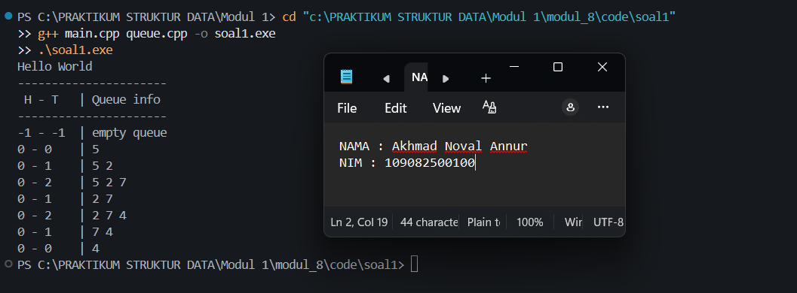
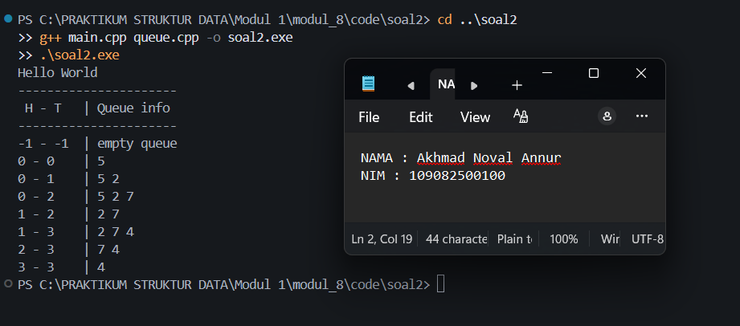
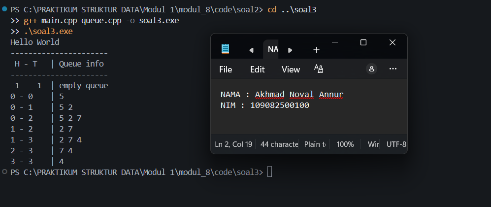

<h1 align="center">Laporan Praktikum Modul 8 - Queue</h1>

<p align="center">Akhmad Noval Annur - 109082500100 - S1IF-13-04</p>

## Dasar Teori

### A. Queue

Queue adalah struktur data yang bekerja seperti antrean. Elemen yang pertama masuk menjadi elemen yang pertama dilayani, sehingga prinsipnya disebut FIFO (*First In First Out*) [1]. Queue memiliki dua ujung, yaitu `Head` sebagai tempat elemen keluar dan `Tail` sebagai tempat elemen masuk. Queue dapat direpresentasikan dengan pointer (linked list) maupun dengan tabel (array) [1].

### B. Operasi Enqueue dan Dequeue

Operasi utama pada queue adalah `enqueue` dan `dequeue`. `enqueue` menyisipkan elemen baru di belakang `Tail`, sedangkan `dequeue` mengambil elemen pada `Head` lalu memindahkan `Head` ke elemen berikutnya [1]. Pada representasi tabel, jumlah elemen dibatasi oleh ukuran array, tetapi tidak memerlukan alokasi dan dealokasi memori seperti representasi pointer [2].

### C. Queue Representasi Tabel

Modul ini membahas tiga alternatif pengelolaan indeks queue pada tabel:

1. **Alternatif 1 (head diam, tail bergerak).** `Head` selalu berada di indeks awal. Setiap `dequeue` menggeser semua elemen satu langkah ke depan, lalu `Tail` mundur.
2. **Alternatif 2 (head dan tail bergerak).** `dequeue` cukup memajukan `Head` tanpa menggeser elemen. Jika `Tail` sudah mencapai indeks maksimum tetapi masih ada ruang kosong di depan `Head` (penuh semu), elemen digeser ke depan terlebih dahulu.
3. **Alternatif 3 (head dan tail berputar).** Setelah indeks maksimum, indeks berikutnya kembali ke indeks awal sehingga tabel dipakai seperti lingkaran (*circular buffer*) dan tidak memerlukan pergeseran [1].

## Soal

1. Buatlah ADT Queue menggunakan array (info : array [5] of infotype, head dan tail : integer) dengan procedure createQueue, enqueue, printInfo serta function isEmptyQueue, isFullQueue, dan dequeue pada file queue.h. Implementasikan pada queue.cpp dengan mekanisme Alternatif 1 (head diam, tail bergerak).
2. Buatlah implementasi ADT Queue pada queue.cpp dengan mekanisme Alternatif 2 (head bergerak, tail bergerak).
3. Buatlah implementasi ADT Queue pada queue.cpp dengan mekanisme Alternatif 3 (head dan tail berputar).

Ketiga soal memakai `queue.h` dan `main.cpp` yang sama sesuai modul, sedangkan isi `queue.cpp` berbeda sesuai alternatifnya.

**queue.h**

```cpp
#ifndef QUEUE_H
#define QUEUE_H

constexpr int MAX_QUEUE = 5;

typedef int infotype;

struct Queue {
    infotype info[MAX_QUEUE];
    int head;
    int tail;
};

void createQueue(Queue& Q);
bool isEmptyQueue(Queue Q);
bool isFullQueue(Queue Q);
void enqueue(Queue& Q, infotype x);
infotype dequeue(Queue& Q);
void printInfo(Queue Q);

#endif
```

**main.cpp**

```cpp
#include "queue.h"

#include <iostream>

using namespace std;

int main() {
    cout << "Hello World" << endl;
    Queue Q;
    createQueue(Q);

    cout << "----------------------" << endl;
    cout << " H - T \t | Queue info" << endl;
    cout << "----------------------" << endl;
    printInfo(Q);
    enqueue(Q, 5); printInfo(Q);
    enqueue(Q, 2); printInfo(Q);
    enqueue(Q, 7); printInfo(Q);
    dequeue(Q); printInfo(Q);
    enqueue(Q, 4); printInfo(Q);
    dequeue(Q); printInfo(Q);
    dequeue(Q); printInfo(Q);

    return 0;
}
```

### 1. Alternatif 1 (Head Diam, Tail Bergerak)

[Sumber program](code/soal1)

**queue.cpp**

```cpp
#include "queue.h"

#include <iostream>

void createQueue(Queue& Q) {
    Q.head = -1;
    Q.tail = -1;
}

bool isEmptyQueue(Queue Q) {
    return Q.head == -1;
}

bool isFullQueue(Queue Q) {
    return Q.tail == MAX_QUEUE - 1;
}

void enqueue(Queue& Q, infotype x) {
    if (isFullQueue(Q)) {
        std::cout << "Queue penuh, " << x << " tidak dapat ditambahkan\n";
        return;
    }
    if (isEmptyQueue(Q)) {
        Q.head = 0;
    }
    Q.tail++;
    Q.info[Q.tail] = x;
}

infotype dequeue(Queue& Q) {
    if (isEmptyQueue(Q)) {
        std::cout << "Queue kosong\n";
        return 0;
    }
    infotype x = Q.info[Q.head];
    for (int i = Q.head; i < Q.tail; i++) {
        Q.info[i] = Q.info[i + 1];
    }
    Q.tail--;
    if (Q.tail < Q.head) {
        createQueue(Q);
    }
    return x;
}

void printInfo(Queue Q) {
    std::cout << Q.head << " - " << Q.tail << "\t | ";
    if (isEmptyQueue(Q)) {
        std::cout << "empty queue\n";
        return;
    }
    for (int i = Q.head; i <= Q.tail; i++) {
        std::cout << Q.info[i] << ' ';
    }
    std::cout << '\n';
}
```

#### Output Soal 1



Pada alternatif ini `head` selalu bernilai 0 selama queue tidak kosong, sedangkan `tail` bergerak mengikuti jumlah elemen. Saat `dequeue`, elemen pada `head` diambil lalu semua elemen di belakangnya digeser satu langkah ke depan dan `tail` mundur. Karena itu, nilai `head` pada output tidak pernah berubah dari 0. Jika elemen terakhir diambil, `head` dan `tail` dikembalikan menjadi -1.

### 2. Alternatif 2 (Head Bergerak, Tail Bergerak)

[Sumber program](code/soal2)

**queue.cpp**

```cpp
#include "queue.h"

#include <iostream>

void createQueue(Queue& Q) {
    Q.head = -1;
    Q.tail = -1;
}

bool isEmptyQueue(Queue Q) {
    return Q.head == -1;
}

bool isFullQueue(Queue Q) {
    return Q.head == 0 && Q.tail == MAX_QUEUE - 1;
}

void enqueue(Queue& Q, infotype x) {
    if (isFullQueue(Q)) {
        std::cout << "Queue penuh, " << x << " tidak dapat ditambahkan\n";
        return;
    }
    if (isEmptyQueue(Q)) {
        Q.head = 0;
        Q.tail = 0;
    } else {
        if (Q.tail == MAX_QUEUE - 1) {
            int n = Q.tail - Q.head + 1;
            for (int i = 0; i < n; i++) {
                Q.info[i] = Q.info[Q.head + i];
            }
            Q.head = 0;
            Q.tail = n - 1;
        }
        Q.tail++;
    }
    Q.info[Q.tail] = x;
}

infotype dequeue(Queue& Q) {
    if (isEmptyQueue(Q)) {
        std::cout << "Queue kosong\n";
        return 0;
    }
    infotype x = Q.info[Q.head];
    if (Q.head == Q.tail) {
        createQueue(Q);
    } else {
        Q.head++;
    }
    return x;
}

void printInfo(Queue Q) {
    std::cout << Q.head << " - " << Q.tail << "\t | ";
    if (isEmptyQueue(Q)) {
        std::cout << "empty queue\n";
        return;
    }
    for (int i = Q.head; i <= Q.tail; i++) {
        std::cout << Q.info[i] << ' ';
    }
    std::cout << '\n';
}
```

#### Output Soal 2



Pada alternatif ini `dequeue` tidak menggeser elemen, melainkan hanya memajukan `head`. Hal ini terlihat dari nilai `head` yang berubah dari 0 menjadi 1, 2, lalu 3. Queue dianggap penuh hanya jika `head = 0` dan `tail = 4`. Jika `tail` sudah berada di indeks 4 tetapi `head` belum di indeks 0, elemen yang tersisa digeser ke awal array terlebih dahulu sebelum elemen baru dimasukkan.

### 3. Alternatif 3 (Head dan Tail Berputar)

[Sumber program](code/soal3)

**queue.cpp**

```cpp
#include "queue.h"

#include <iostream>


void createQueue(Queue& Q) {
    Q.head = -1;
    Q.tail = -1;
}

bool isEmptyQueue(Queue Q) {
    return Q.head == -1;
}

bool isFullQueue(Queue Q) {
    return !isEmptyQueue(Q) && (Q.tail + 1) % MAX_QUEUE == Q.head;
}

void enqueue(Queue& Q, infotype x) {
    if (isFullQueue(Q)) {
        std::cout << "Queue penuh, " << x << " tidak dapat ditambahkan\n";
        return;
    }
    if (isEmptyQueue(Q)) {
        Q.head = 0;
        Q.tail = 0;
    } else {
        Q.tail = (Q.tail + 1) % MAX_QUEUE;
    }
    Q.info[Q.tail] = x;
}

infotype dequeue(Queue& Q) {
    if (isEmptyQueue(Q)) {
        std::cout << "Queue kosong\n";
        return 0;
    }
    infotype x = Q.info[Q.head];
    if (Q.head == Q.tail) {
        createQueue(Q);
    } else {
        Q.head = (Q.head + 1) % MAX_QUEUE;
    }
    return x;
}

void printInfo(Queue Q) {
    std::cout << Q.head << " - " << Q.tail << "\t | ";
    if (isEmptyQueue(Q)) {
        std::cout << "empty queue\n";
        return;
    }
    int i = Q.head;
    while (true) {
        std::cout << Q.info[i] << ' ';
        if (i == Q.tail) {
            break;
        }
        i = (i + 1) % MAX_QUEUE;
    }
    std::cout << '\n';
}
```

#### Output Soal 3



Pada alternatif ini indeks berikutnya dihitung dengan `(indeks + 1) % MAX_QUEUE`, sehingga setelah indeks 4 kembali ke indeks 0. Queue penuh jika posisi setelah `tail` adalah `head`. `printInfo` menelusuri elemen dari `head` sampai `tail` dengan rumus yang sama agar urutan tetap benar walaupun `tail` sudah berputar ke depan. Output soal 3 sama dengan soal 2 karena pada urutan operasi ini `tail` belum mencapai indeks 4, sehingga indeks belum perlu berputar.

## Kesimpulan

Queue bekerja dengan prinsip FIFO, yaitu elemen yang pertama masuk menjadi elemen yang pertama keluar, dengan penyisipan pada `Tail` dan penghapusan pada `Head`. ADT queue dengan array 5 elemen berhasil dibuat dengan tiga alternatif. Alternatif 1 menggeser elemen setiap dequeue, Alternatif 2 hanya memajukan `head` dan menggeser elemen saat terjadi penuh semu, sedangkan Alternatif 3 memakai indeks berputar sehingga tidak memerlukan pergeseran. Ketiga program menghasilkan isi queue yang sama, tetapi posisi `head` dan `tail` berbeda sesuai mekanisme masing-masing.

## Referensi

[1] Triase. (2020). *Diktat Edisi Revisi: Struktur Data*. Universitas Islam Negeri Sumatera Utara, Medan. [Dokumen PDF](https://repository.uinsu.ac.id/9717/2/Diktat%20Struktur%20Data.pdf).

[2] Indahyanti, U., & Rahmawati, Y. (2020). *Buku Ajar Algoritma dan Pemrograman dalam Bahasa C++*. Umsida Press. [https://doi.org/10.21070/2020/978-623-6833-67-4](https://doi.org/10.21070/2020/978-623-6833-67-4).
